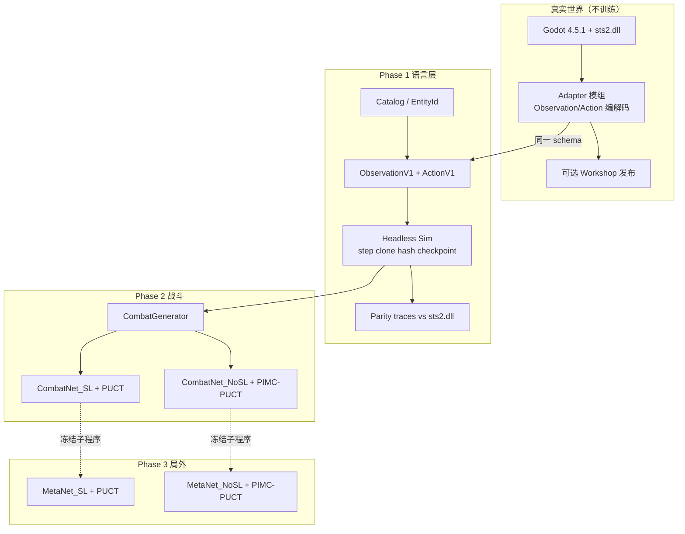
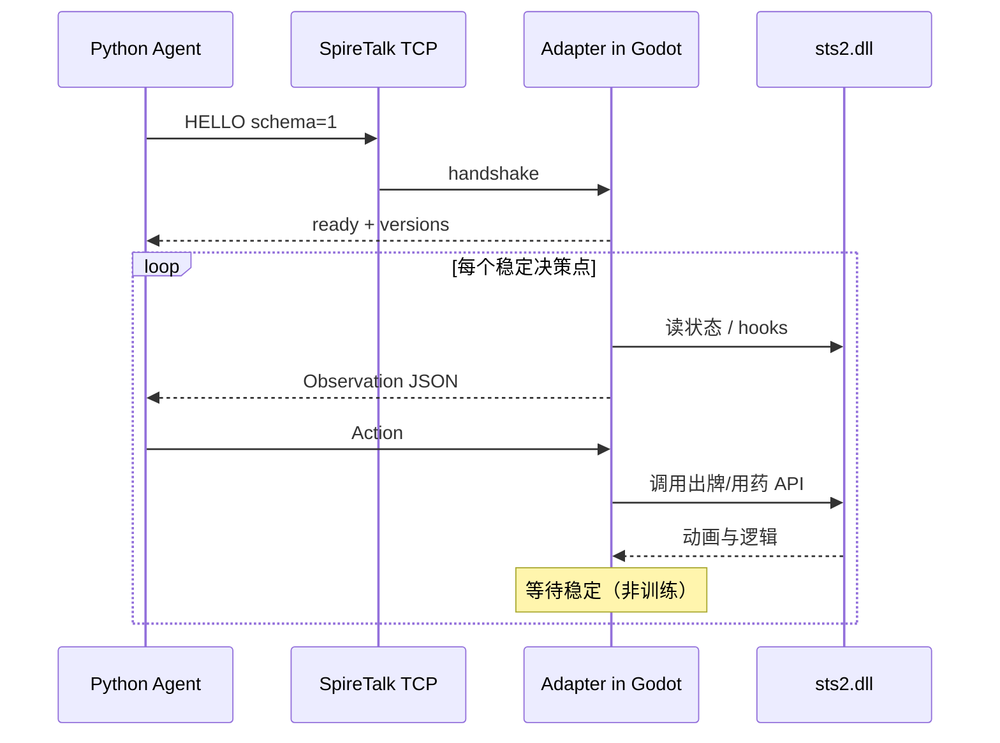
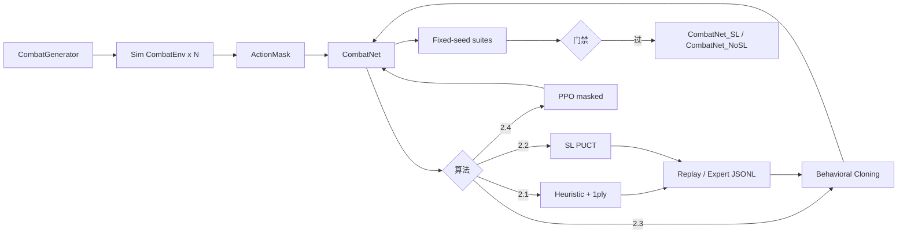
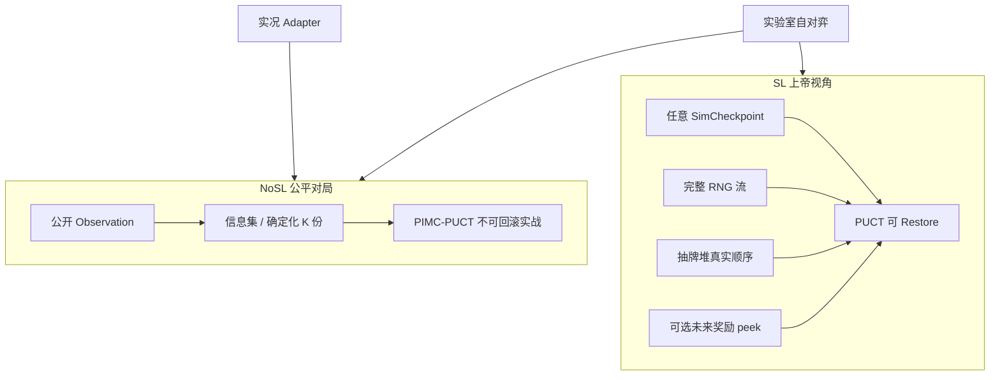

# STS2 Playing AI 系统设计与实现计划

| 字段 | 值 |
| --- | --- |
| 文档标题 | Slay the Spire 2 Playing AI 系统设计与实现计划 |
| 仓库 | [https://github.com/Mountablet/shalujianta](https://github.com/Mountablet/shalujianta) |
| 作者 | Mountablet |
| 日期 | 2026-08-15 |
| 状态 | Draft（rev.3，Q1/Q2 已决） |
| 游戏 | Slay the Spire 2 Early Access（Steam app `2868840`，2026-03-05 上线） |
| 引擎 | 修改版 Godot 4.5.1 + C# / .NET 9，逻辑在 `sts2.dll` |
| 受众 | 将亲自审查每一节的资深工程师（即仓库所有者本人） |
| 修订 | rev.3：Q1=Ironclad、Q2=C# / .NET 9 由所有者锁定（2026-08-15）；回合机只在 PlayerTurnStart 抽 5 |

本文是 **可实施规格**，不是愿景幻灯片。每一个子系统、数据字段、算法、缺省机制、训练模式都必须能直接开工。标识符、算法名、论文名、仓库名、文件路径保持英文；叙述使用简体中文。

**官方 v0 垂直切片（不可谈判）**：单一角色（**所有者已决：Ironclad**，Q1，2026-08-15）+ Act 1 hallway + 出牌/用药水/结束回合 + **冻结白名单 `SliceV0`（§4.1.1，所有者已确认）** + Heuristic40 基线。在这一切片通过之前，禁止在 Godot 客户端里训练，禁止铺开五角色全图，禁止把「能看懂 JSON」当成完成。**v0 交付线 = PR-000–PR-012**；Adapter / 学习策略 / 局外 / 第二角色全部是 post-v0。

---

## Overview

STS2 没有官方无头模拟器，也没有 STS1 的 `CommunicationMod` / `spirecomm` 等价物。在真实 Godot 客户端里训练太慢，且会把动画、UI 稳定性和网络/创意工坊生命周期绑进学习环。本设计把问题拆成用户指定的三层，并给每层可执行的接口：

1. **Phase 1 — Protocol & Simulator（游戏状态与动作的计算机语言）**：把战斗与局外决策编码成稳定的 `Observation` / `Action`，实现可 `step()` / `clone()` / `hash()` 的确定性模拟器。这是人机交互层，不是「战斗生成器」。
2. **Phase 2 — Combat Generation & In-Combat Policy**：用模拟器生成战斗，训练战斗策略。网络必须预留局外条件（层数、金币、药水局外价值、即将到来的 Boss），即使 Phase 3 尚未存在。
3. **Phase 3 — Frozen Combat + Meta Search / Policy**：冻结战斗参数，学习选牌、删牌、休息、商店、事件、走图。全程一等公民地维护 **SL** 与 **NoSL** 两套信息集、两套搜索、两套 checkpoint。

默认技术栈（单人 Windows 工作站，GPU 未知）：

- 模拟器核心 **已决为 C# / .NET 9 struct-of-arrays**（Q2，所有者 2026-08-15；与 `sts2.dll` 同语言，便于对照反编译；v0 先求正确，再求速度）。C++ 仅作吞吐逃逸舱。
- 训练与搜索编排用 **Python 3.12 + PyTorch**。
- 真实游戏适配器用 **C# Godot mod**（Workshop 友好），只消费同一套 Observation/Action，**不是训练环境**。
- 算法默认栈（**v0 停在启发**；其后为 post-v0）：**合法随机 → 加权启发 + 浅层搜索** →（post-v0）知情 RNG 的 PUCT 专家 → Behavioral Cloning → 有 mask 的 PPO。隐藏信息搜索默认名是 **`PIMC-PUCT`**，不是 ISMCTS（见 §5.7 与 Alternatives H）。不要从零在 Godot 里跑 PPO。

---

## Background & Motivation

### 当前状态

仓库 `shalujianta` 是绿场：目前只有 `README.md` 与 `.gitignore`。游戏侧事实：

| 项目 | EA 约数 / 事实 | 对 AI 的含义 |
| --- | --- | --- |
| 角色 | 5：Ironclad、Silent、Defect、Regent、Necrobinder | 必须预留 companion / orb / star / stance 槽；v0 只实现 1 个 |
| 卡 | 575+ | embedding 表必须可热扩，不能因补丁加卡而崩 |
| 遗物 | 278 | 被动战斗效果 + 局外估值两套通路 |
| 药水 | 63 | 出牌语言必须包含用药水 / 弃药水 |
| 敌人 | 115+ | intent 状态机、未知意图、多目标 |
| 章节 | 3 幕；Act 1 已有 A/B（Underdocks / Overgrowth） | 地图与遭遇分布分叉；CRNG 使幕变体与奖励相关 |
| 进阶 | Ascension 0–10 | 修改器必须进入 `RunContext` |
| 合作 | 可选 4 人、hash lockstep | **明确不在范围内**，但 Observation 预留 `player_count` |
| 模组 | 官方 Workshop；`jiegec/STS2FirstMod`；`elliotttate/sts2-modding-mcp`（README 自称 ~144 hooks / 175 overridable methods，**本仓库未独立核实**） | 适配器可行；无头模拟器仍需自写 |
| 数据 | `ptrlrd/spire-codex` / [spire-codex.com](https://spire-codex.com) | 目录、ID、遭遇、事件树的权威外部源 |

### 痛点

1. **没有 headless sim**：不能像 `sts_lightspeed` 那样每秒百万级随机对局。
2. **没有 CommunicationMod**：不能先接真实客户端再补模拟器；必须协议先行。
3. **STS2 机制比 STS1 宽**：Enchantment、Affliction、Ancient、Act 变体、Necrobinder 的 Osty、Regent 星尘、CRNG（`System.Random` 线性相关）。
4. **Early Access 平衡每周可能变**：任何把卡牌效果硬编码进网络结构的设计都会在补丁后报废。
5. **单人开发**：不能同时写五角色完美模拟器、分布式 RL 和 Workshop 发布。必须垂直切片。

### 用户原话必须保留的骨架

- 「不要在真实 Godot 游戏里训练，太慢。目的是学会打牌，用计算机模拟器。」
- 「这其实是计算机与应用程序的交互层，必须考虑全面。」
- 「所有可能的 embedding 情况先编码。初始权重可以随机。」
- 「必须包含打牌 **和** 喝药水。」
- 「重要的是把这些行为变成计算机能读的语言。」
- 「不要叫战斗生成器。这一步是把游戏变成计算机可读语言。」
- Phase 2 同时是战斗生成 **和** 策略学习。
- Phase 3 冻结战斗机器人后学局外；预先准备 SL / NoSL 两套打法、两套参数。

---

## Goals & Non-Goals

### Goals

- G1. 定义并冻结 `ObservationV1` / `ActionV1` / `ActionMaskV1`，覆盖战斗与局外全部决策类型（未实现的机制以保留字段存在，而不是事后改 schema）。
- G2. 实现确定性、可克隆、可哈希的模拟器，RNG 模型与 STS2 的多流 `seed + hash(name)` 对齐（并记录 CRNG 现状）。
- G3. 真实客户端适配器复用同一协议，永不作为训练 env。
- G4. **官方 v0** 交付 Heuristic40，并在固定种子集上可复现地超过合法随机。超过启发的学习策略（BC / PPO）是 **Phase 2 / post-v0** 目标，不是 v0 门禁。
- G5. 局外策略把战斗当作子程序调用冻结的 CombatNet / CombatSearch（**仅当** 冻结门禁 `CombatFreezeCriterion` 通过，见 §6.1）。
- G6. SL 与 NoSL 从第一天就是两套 **信息集、投影、搜索能力接口与审计**（PR-002 起），而不是一个开关脚注。两套 **训练好的** checkpoint 是 post-v0 产物。
- G7. 法律安全：公共 GitHub 永不提交 `sts2.dll`、反编译源、PCK、游戏资源。
- G8. 单机可跑：一台 Windows PC 完成 v0；吞吐与 checkpoint 尺寸量化。

### Non-Goals

- NG1. 在 Godot 客户端内做 PPO / IMPALA / 任何梯度更新。
- NG2. v0 实现全部 5 角色、3 幕、Ascension 10、合作模式。
- NG3. 100% 卡牌效果在 v0 就与 `sts2.dll` 逐字节一致（v0 求「已实现子集的黄金测试全绿」；全量校验属于 v1/v2）。
- NG4. 提交或分发专有游戏二进制。
- NG5. 把 Workshop 上架当 Phase 1 完成条件。
- NG6. 多人对战、hash lockstep、反作弊绕过。
- NG7. 用视觉/截图当主观察（允许以后做 debug overlay，不进训练张量）。
- NG8. 声称能利用或「修复」官方 CRNG；模拟器必须 **复现** 当前 PRNG，并在官方更换生成器时切换 `RngBackend`。

---

## 1. 术语表

| 术语 | 英文标识 | 精确定义 |
| --- | --- | --- |
| Observation | `Observation` | 智能体在某一决策点看到的结构化状态。有 SL 与 NoSL 两个投影。 |
| Action | `Action` | 单一合法原语：打牌、用药、结束回合、选节点、选奖励等。 |
| ActionMask | `ActionMask` | 与当前 `screen` 对齐的布尔/稀疏合法集。非法动作 `step()` 必须拒绝。 |
| 模拟器 | `Sim` / `CombatEnv` / `RunEnv` | 无头、无 Godot、纯逻辑的转移函数。训练只走这里。 |
| 适配器 | `Adapter` | STS2 版 CommunicationMod。把真实客户端译成同一 Observation/Action。不训练。 |
| 战斗策略 | `CombatPolicy` / `CombatNet` | 给定战斗 Observation，输出动作分布与价值。 |
| 局外策略 | `MetaPolicy` / `MetaNet` | 给定非战斗 Observation，输出选牌/走图等。 |
| SL | `SaveLoad` / `GodModeInfo` | 允许读档到任意 checkpoint，允许条件于完整 RNG 流与隐藏牌序。上界、教师、实验室工具。 |
| NoSL | `FairPlay` / `HiddenInfo` | 实战不可读档；不可观察抽牌堆顺序与未来地图奖励。可上 Workshop 的公平机器人。 |
| 信息集 | `InfoSet` | NoSL 下智能体无法区分的状态集合。 |
| Checkpoint | `SimCheckpoint` | 完整模拟器快照（牌堆顺序、能力层数、所有 RNG 计数器）。这才是真正的 SL 原语。 |
| 目录 | `Catalog` | 卡/遗物/药水/能力/敌人的稳定 ID 表。来自 spire-codex + 本地补丁清单。 |
| Embedding 表 | `EntityTable` | `nn.Embedding(num_entities, D)`，初始随机，按命名空间分表。 |
| 未知实体 | `UNK` | 补丁新增、尚未登记的实体走此槽 + 侧写特征，不崩推理。 |
| CRNG | Correlated RNG | STS2 用 `System.Random` 且种子为 `seed+hash(name)`，各流首样本线性相关。见 tck.mn 2026-06-15。 |
| v0 切片 | `SliceV0` | 冻结白名单：Ironclad 起始套 + Burning Blood + 指定药水 + 指定 Act 1 hallway 遭遇。见 §4.1.1。 |
| PIMC-PUCT | `PIMC-PUCT` | Perfect Information Monte Carlo：对隐藏变量做 K 次确定化，每个确定化里跑浅 PUCT，按信息集合并。**不是** ISMCTS。 |
| NoSL 搜索世界 | `INoSlSearchWorld` | 唯一允许 NoSL 搜索持有的句柄。无 `Clone()` / `Seed(publicSeed)` / `ExportState`。 |
| Agent_SL | `Agent_SL` | `(CombatNet_SL, MetaNet_SL, SearchConfig_SL)` |
| Agent_NoSL | `Agent_NoSL` | `(CombatNet_NoSL, MetaNet_NoSL, SearchConfig_NoSL)` |

用户口头「战斗生成器」在本文中的工程名：

| 用户原话 | 工程名称 | 所属阶段 |
| --- | --- | --- |
| 「把游戏变成计算机能读的语言」 | `protocol` + `sim` | Phase 1 |
| 「战斗生成」 | `CombatGenerator` / `EncounterSampler` | Phase 2 |
| 「局内策略学习」 | `CombatPolicy` 训练环 | Phase 2 |
| 「固定战斗机器人后的局外」 | `MetaSearch` / `MetaPolicy` | Phase 3 |
| 「读档上帝视角」 | `SL` | 贯穿 |
| 「公平对局」 | `NoSL` | 贯穿 |

---

## 2. 系统总览与三阶段对照



三阶段对照（用户原话 → 交付物）：

| 阶段 | 用户原话 | 工程交付物 | 完成判据 |
| --- | --- | --- | --- |
| 1 | 计算机语言，不是战斗生成器 | `shalujianta-proto`、`Shalujianta.Sim`、`catalog/`（Adapter **不是** Phase 1 / v0 交付物） | 随机合法策略可在 sim 中打完 v0 遭遇；黄金测试通过（首帧 `len(hand)==5`）；schema 覆盖全部动作动词 |
| 2 | 战斗生成 + 局内策略 | `CombatGenerator`、启发基线、SL 专家、BC、可选 PPO | 固定种子集上胜率/剩余 HP 超过启发；吞吐达标 |
| 3 | 冻结战斗后学局外 | `RunEnv`、Meta MCTS、两套 Agent checkpoint | Act 1 完整 run 胜率可报告；NoSL 公平审计通过 |

---

## 3. 先验工作（STS1 / STS2）

必须引用并抽取教训。禁止在本项目里重复已失败的动作表示。

### 3.1 CommunicationMod（ForgottenArbiter）

- 仓库：`ForgottenArbiter/CommunicationMod`
- 机制：启动外部进程，stdin/stdout 换行 JSON。先等 `ready`，游戏稳定后推送 state，再等命令。
- 命令：`START`、`PLAY`、`END`、`POTION`、`CHOOSE`、`PROCEED`、`RETURN`（=`SKIP`/`CANCEL`/`LEAVE`）、`KEY`、`CLICK`、`WAIT`、`STATE`。
- 状态包含：`combat_state`（hand / draw / discard / exhaust / limbo、monsters+intents、player energy/block/orbs/powers）、`deck`、`relics`、`potions`、`map`（`M/?/$/E/R/T` + x/y + children/parents）、`act`、`floor`、`seed`、`screen_type`、`ascension_level`、`class`。
- **教训：协议第一，AI 第二。** 本项目的 Adapter 命令集必须是 CommunicationMod 的超集，并新增 STS2 专有屏幕（Enchantment、Ancient、Act 变体、companion）。
- 已知坑：药水满时无反馈；手牌反选不支持；必须开 fast mode。Adapter 设计时显式处理。

### 3.2 spirecomm

- Python 客户端 + 简单规则 AI。
- **教训**：Python 编排层与游戏进程解耦；本项目的 `python/shalujianta/protocol` 对标它，但类型用 pydantic v2，且同时能打 sim 与 Adapter。

### 3.3 sts_lightspeed（gamerpuppy）

- C++17，目标 100% RNG 准确，`clone` 做树搜索，Ironclad+无色完整。
- 速度：README 写「1M random playouts in 5s with 16 threads」。算术：合计 **2.0×10⁵ playouts/s**，折合 **1.25×10⁴ playouts/s/thread**。不要写成 2e5/s/thread（那是把合计误标到每线程上，高了 16 倍）。
- 已有：知情 RNG 的树搜索；从存档加载进战斗。
- 计划中：不知 RNG 的结果树搜索 ≡ 本项目 NoSL。
- **教训：速度和确定性打败花哨 RL。** 本项目吞吐指标按它标定，但不在 v0 承诺同等速度。C++ 是速度上限参考，不是 v0 必选语言。

### 3.4 Bottled AI / requested_strike（xaved88）

- **不是 ML。** 选牌/Boss 遗物/升级用优先列表。
- 战斗：枚举手牌打出顺序（图 + 模拟），约 40 个加权特征打分。
- 作者自称约 Watcher 52%、Ironclad 20%。公开说明里 Ironclad 的 CI 大约 8.9–31.1%（n 约 50 量级）。本文引用点估计时必须带着这个区间，不当成可复现 SOTA。
- **教训：强启发 + 浅搜索是第一个真正能打的机器人。** Phase 2 的 Baseline 必须先达到这个形态，再谈神经网络。

### 3.5 MiniStS

- 简化无头环境，适合实验智能体。
- **教训**：可以先做一个 **机制子集** 环境；但 schema 必须按全游戏预留，避免 MiniStS 式接口在接 STS2 时推翻。

### 3.6 conquer-the-spire

- C++ sim + PyTorch C++ RL 尝试。
- **教训**：C++/LibTorch 绑定成本高，单人项目容易卡在基础设施。默认不走这条，除非 C# 吞吐证明不够。

### 3.7 Slay-I / Driedger fight predictor

- ANN 用套牌+遗物+敌人预测战斗伤害，用于评估选牌。
- **教训**：Phase 3 的叶子评估可以是「期望掉血 / 胜率」，不必每次展开完整 MCTS。本项目的 `CombatEvaluator` 就是这个角色，但是用冻结的 CombatNet value 头，而不是另起一个与策略无关的伤害回归器（后者可作为辅助损失）。

### 3.8 Kai Brewer-Krebs rllib PPO

- 动作 = `(hand index × target)`。失败原因之一：策略从未把 **卡牌身份** 当作动作的一部分。
- **教训：禁止再犯。** 动作头必须是 pointer over **实体 embedding**（这张具体的 Strike+ / 这个药水），而不是纯槽位下标。槽位下标只作为对齐用的定位器。

### 3.9 CCG draft RL（Vieira 2020 等）

- 冻结对战器，训练选牌器；选牌器上限 = 对战器上限。
- **教训**：Phase 3 在战斗机器人稳定前启动，是在训练一个拟合弱对手的错误 meta。

### 3.10 STS2 模组与数据

| 项目 | 用途 |
| --- | --- |
| `jiegec/STS2FirstMod` | Godot.NET.Sdk/4.5.1、net9.0、引用 `sts2.dll`、`[ModInitializer("ModLoaded")]`。Adapter 脚手架照抄。 |
| `elliotttate/sts2-modding-mcp` | 反编译、存档指南、20x playtest。README 自称 ~144 hooks / 175 overridable methods——**未在本仓库核实**，实现时以本机 `ilspycmd` 索引为准。不把该 MCP 当运行时依赖。 |
| `ptrlrd/spire-codex` | 从反编译 C# 抽卡/角色/遗物/药水/怪物招式机/事件树。`Catalog` 的生成源。禁止把反编译源提交到本仓库。 |
| `tck.mn/blog/correlated-randomness-sts2` | RNG 流名单与 CRNG。模拟器必须按流实现，并在 `RngBackend` 中标注 `SystemRandomLegacy` vs 未来 `Pcg32`。 |
| `Gennadiyev/STS2MCP` / ClaudePlays 类 IPC | 证明社区已在做「状态+命令」通道。本项目协议必须比截图/REST 更适合神经网络：有固定张量布局与 mask。 |

从 CRNG 文抽出的 **必须建模的 RNG 流**（不完整，以反编译 `RunState.Rng` 为准）。PR-003 **必须**提交 `catalog/generated/rng_stream_hash_strings.json`：枚举名 → 官方 hash 字符串。tck.mn 已公布的字面量是 **snake 小写**，不是 PascalCase：

| `RngStream` 枚举 | 官方 hash 字符串（tck.mn / 待 dll 核对） |
| --- | --- |
| `UpFront` | `up_front` |
| `Shuffle` | `shuffle` |
| `UnknownMapPoint` | `unknown_map_point` |
| `CombatCardGeneration` | `combat_card_generation` |
| `CombatPotionGeneration` | `combat_potion_generation` |
| `CombatCardSelection` | `combat_card_selection` |
| `CombatEnergyCosts` | `combat_energy_costs` |
| `CombatTargets` | `combat_targets` |
| `MonsterAi` | `monster_ai` |
| `Niche` | `niche` |
| `CombatOrbGeneration` | `combat_orbs` |
| `TreasureRoomRelics` | `treasure_room_relics` |
| `Neow` | `NEOW`（种子为 `seed + 1 + hash`） |

种子公式（教学简化，实现时以 `sts2.dll` 为准）：

```csharp
new Rng(seed + Hash(streamName))
// Neow: seed + 1 + Hash("NEOW")
// 事件在多人下还会加上 Steam ID；单人默认 1
```

**CRNG 时效**：tck.mn 写于 2026-06-15、针对 v0.107.0；Mega Crit 已知悉。PR-003 开工前必须在开发者本机当前 `game_version_string` 上复测「两流首样本是否仍线性相关」。若官方已换 PRNG，默认 backend 改为 `Pcg32`（或新算法），`SystemRandomLegacy` 仅作旧档回放。每个 `SimCheckpoint` **钉死** `game_version_string`。

存档方式（STS1/STS2 同类）：存每个 RNG 的 **调用次数**，读档时空转推进。模拟器的 `SimCheckpoint` 直接存 `SeedArray`/`inext`/`inextp` 或等价内部状态，避免每次 restore 空转。

---

## Proposed Design

下面三节是正文。先给全局接口，再按阶段拆开。

### 0. 全局不变量

1. **同一 schema 驱动 Sim 与 Adapter。** 若 Adapter 能发出而 Sim 不能执行的动作，算协议 bug。
2. **非法动作永不进入策略梯度。** mask 在 env 与网络两侧都执行。
3. **`Step` 是确定性、就地修改（mutating）**：`world.Step(action)` 改 `this` 并返回 `StepResult`。相同 checkpoint + 相同动作 ⇒ 相同后继。无隐藏全局、无 IO。需要纯函数时调用方先 `Clone()`（仅 SL）再 `Step`。**禁止**按 copy-on-write 实现 `Step`。
4. **`Clone()` 只属于 SL。** 它深拷贝含牌序与全部 RNG 内部的真世界。NoSL 搜索只能拿 `INoSlSearchWorld`（`CloneForSearch` / `ResampleHidden`），见 §4.10.1。
5. **`Hash64(state)`** 用于 SL 转置表，含全部影响转移的字段（含 RNG）。**`InfoSetHash64`** 只哈希 §4.10.2 列出的公开字段。
6. **Schema 版本化**：`schema_version: uint16`。破坏性变更 +1，旧 checkpoint 拒绝加载并打印双方版本。
7. **目录版本化**：`catalog_version` 绑定游戏版本字符串（例如 `0.107.0`）+ 本仓库修订号。
8. **金币唯一真源**是 `RunContext.gold`。`PlayerState` 不再单列 `gold`；战斗中的金钱效果（若实现）直接改 `run.gold`。

---

## 4. 阶段一详细设计 — 游戏状态与动作的计算机语言

### 4.1 阶段目标与非目标

**目标**：让计算机能读、能写、能回放、能搜索 STS2 的每一个决策点。

**不是**：生成战斗、训练网络、在 Godot 里跑。

**完成定义（Phase 1 DoD，与官方 v0 对齐后的口径）**：

- Schema + 代码生成物一致；NoSL JSON **物理上不能**含抽牌顺序或 `rng_counters`（PR-002 单测）。
- `python -m shalujianta.tools.random_rollout --slice v0 --n 10000` 无崩溃。
- `tests/golden/` 中 SliceV0 合成对局全绿（不加载 `sts2.dll`）。
- 吞吐尽力达到 1e4 `step/s`；**未达标只写报告，不挡 Phase 1 / 官方 v0**。

**不是 Phase 1 / 官方 v0 的门禁**（并行、本机、post-v0）：

- Adapter 冒烟（PR-013）。
- 真实 `sts2.dll` parity `byte-diff == 0`（PR-014，本机；与 NG3 一致：v0 不要求与 dll 逐字节相同）。
- 任何神经网络或 PPO。

### 4.1.1 冻结白名单 `SliceV0`

官方 v0 **只**实现下表。表外实体可以出现在 Catalog / embedding 预留行，但 `CombatGenerator` 与评估套件必须拒绝采样。**本表内容已由所有者确认（2026-08-15）**，不再是「实施默认待改」。数值以 slaythespire.wiki.gg `STS2:Ironclad`（2026-08 核对）为准；招式机伤害 **不在本文臆造**，实现时从本机反编译填入 `catalog/patches/slice_v0_moves.json`（只提交数值表，不提交 C# 源）。

| 项 | 冻结值 | 备注 |
| --- | --- | --- |
| 角色 | Ironclad | **Q1 已决**（2026-08-15），不是推荐默认 |
| Ascension | 0 | v0 不实现 A1–A10 修改器 |
| 最大 / 当前 HP | 80 / 80 | A2+ 为 64，v0 不做 |
| 能量 | `max_energy=3`，回合开始回满 | 见 PR-004 回合机 |
| 抽牌 / 手牌上限 | **只在 `PlayerTurnStart` 抽 5**（第 1 回合即开局手牌）；`BattleStart` 不抽；手牌硬上限 **10** | 第 11 张：按 STS 惯例不能抽进手，留在抽牌堆顶；`HAND_OVERFLOW` hook 先 stub 打日志 |
| 起始套 | Strike_R ×5，Defend_R ×4，Bash ×1 | 目录字符串以 dump 为准 |
| 起始遗物 | **Burning Blood**（战后治疗 6） | **必须在 PR-005**，否则多战 hallway 的剩余 HP 指标是错的 |
| 药水槽 | 3，开局空 | |
| 已实现药水 | `FirePotion`（单体伤害）、`BlockPotion`（自身格挡） | 若当前 EA 改名，用 `catalog/patches/aliases.yaml`；禁止在 v0 实现 X 费/选牌药水 |
| C0 内核单测遭遇 | `TwoTailedRat × 1` | 单怪，只测内核；**不是**评估套件 |
| C0/C1 评估遭遇（真 hallway） | `Act1_TwoTailedRats` = Two-Tailed Rat ×2 | 真实 STS2 Act 1 走廊战（**不是** STS1 Jaw Worm）。双怪用来跑通 9 槽目标 mask |
| C1 扩展遭遇（PR-005b） | `CorpseSlugs`、`Toadpoles` | tck.mn 记载的 Underdocks easy 多敌池；招式机本机核对 |
| C2 遭遇 | PR-005b 表 ∪ 其余已实现 Act 1 MonsterRoom | 均匀采样，**不**声称 Codex 有权重 |
| v0 已实现卡（PR-005） | 仅起始三类型 | 无 X 费、无手牌选择、无生成牌 |
| v0 已实现能力 | Vulnerable（Bash），以及敌人招式机实际用到的 Weak/Strength 等 | 核心 8 个：**Vulnerable, Weak, Strength, Dexterity, Frail, Poison, Artifact, Buffer**；未碰到的只留 hook stub |
| v0 已实现遗物钩子 | Burning Blood `OnCombatEndHeal` | 其它遗物 PR-019 |
| v0 禁用动词 | `HAND_SELECT_*`、`TARGET_SELECT` 二段、X-cost `extra≠0` | mask 恒 0 |
| v0 目标槽 | 见 §4.9：companion 槽位存在但 **永久 mask=0** | |
| 幕变体 | Underdocks / Overgrowth 对遭遇表 50/50 | 这是缺省先验，不是测得分布 |

**禁止**再使用 `JawWorm` / `ironclad_jawworm_seed42` 作为文件名。黄金测试改为 `tests/golden/ironclad_twotailedrats_seed42.json`。首个 `COMBAT` Observation **必须**断言 `len(hand)==5`（见 §4.11：开局手牌只由第一次 `PlayerTurnStart` 抽出）。

### 4.2 实现语言与分层（C++ vs C# vs Python；Q2 已决）

所有者 2026-08-15 锁定：**Sim = C# / .NET 9**。Python 只做训练与搜索编排。C++ 仍只是吞吐逃逸舱，不是待选主语言。

| 层 | 已决 / 角色 | 理由 | 放弃的选项 |
| --- | --- | --- | --- |
| Sim 核心 | **已决 C# / .NET 9**，`struct` + 对象池 | 与 `sts2.dll` 同语言；反编译可对照；单人 Windows 调试成本最低；可用 `Source Generator` 生成 `clone/hash` | v0 不用 C++（正确性周期太长）；不用 Python（clone 太慢、GIL） |
| 热路径备选 | 若 C# 单线程 `< 1e4 steps/s` 持续 2 个里程碑 | 把 `CombatState` 抽成 C++20 SoA，经 C ABI 暴露 | 不预先 All-in C++ |
| 训练 | Python 3.12 + PyTorch | 生态；单人生产力 | 不用 LibTorch C++ 主训 |
| 适配器 | C# Godot 模组，net9.0，Godot.NET.Sdk/4.5.1 | 与 `STS2FirstMod` 相同加载路径 | 不注入 Python 进游戏进程 |
| 协议 | JSON（人读/录制）+ 定长二进制（训练） | JSON 用于 parity 与 Adapter；binary 用于 1e5+ steps/s | 训练热路径不解析 JSON |

**C# 必须遵守的性能约束**（否则必重写）：

- `CombatState` 是 `class` 外壳 + 内嵌 `struct` 数组，禁止每张卡 `new Card()`。
- 牌用 `CardInstance : struct { uint catalog_id; byte upgrade; byte flags; int uuid; int misc; }`。`catalog_id` 存 **完整 32-bit EntityId**（`namespace<<24 | local_id`），不用 `ushort`（装不下）。热路径查表时用 `local = catalog_id & 0x00FFFFFF`。
- `Clone()`（SL）用 `Array.Copy` / `CloneBuffer`，禁止 LINQ。NoSL 禁止走这条路径。
- 热路径零异常、零装箱、零 `string`。
- 多环境 = 多 `SimWorld` 实例，不共享可变静态。

**与 sts_lightspeed 的对标**：他们用 C++17 换速度。我们用 C# 换「能对着 `sts2.dll` 写对」。v0 目标低一个数量级；v1 再决定是否抽 C++。

### 4.3 仓库布局（Phase 1 必须落地的部分）

```
shalujianta/
  docs/                          # 本设计与后续 RFC
  catalog/                       # 生成的实体目录，无游戏二进制
    raw/                         # 从 spire-codex API 拉下来的 JSON（可提交摘要）
    generated/
      entity_ids.json
      card_table.parquet
      schema_version.json
    patches/                     # 手工覆盖：错误 HP、漏招式
  proto/
    observation.schema.json
    action.schema.json
    checkpoint.schema.json
  src/
    Shalujianta.Sim/             # C# 模拟器
      Core/                      # EntityId, Rng, Checkpoint
      Combat/
      Run/
      Cards/                     # 每张已实现卡一个 static Apply
      Monsters/
      Relics/
      Potions/
      Events/
      Codec/                     # Observation/Action 编解码
    Shalujianta.Sim.Tests/
    Shalujianta.Adapter/         # Godot 模组，不引用训练代码
    Shalujianta.Bindings/        # C ABI / gRPC 给 Python
  python/
    shalujianta/
      protocol/                  # pydantic 镜像
      env/                       # gymnasium.Env 包装
      nets/
      search/
      train/
      eval/
      tools/
  traces/                        # git-lfs 或本机；真实对局录音
    .gitkeep
  third_party/                   # 仅本地
    sts2.dll                     # gitignore
    decompiled/                  # gitignore
  tools/
    dump_catalog.py
    record_trace.py
    parity_runner.py
    replay_viewer/               # 简易 Web 回放
  .gitignore                     # 必须忽略 dll / decompiled / *.pck / 权重可选
```

`.gitignore` 必加（PR-000 第一批合并；`checkpoints/*.pt` **不能**匹配 `checkpoints/agent_sl/combat.pt`）：

```
# 游戏与反编译（整棵 third_party 默认本地）
third_party/
**/sts2.dll
**/decompiled/
**/*.pck

# 权重与游戏存档
checkpoints/**/*.pt
checkpoints/**/*.ckpt
**/*.pt
!python/tests/fixtures/tiny_random.pt
*.run

# 本机录音（可含路径/用户信息）
traces/real/

# 不要用 **/*.dll：会误伤以后自研 native addon。
# Adapter 的 HintPath 必须指向本机游戏安装目录或环境变量 STS2_DLL，
# 禁止仓库相对路径下的已提交二进制。
```

CI（`.github/workflows/legal.yml`，PR-000 带一个**必定失败的夹具**证明扫描在干活）：

- 拒绝路径匹配：`sts2.dll`、`decompiled/`、`MegaCrit`、`*.pck`、`third_party/`。
- 拒绝单文件 > 8 MB（权重走 Release / Git LFS，不进 `main`）。
- `dotnet restore` 不得解析名为 `sts2` 的 nuget / `HintPath` 指向仓库内 dll。
- Catalog CI 只读 `catalog/ci/synthetic/`（十来个假实体），**禁止**打 live Codex API。

**允许提交的 Codex 衍生数据**：`entity_ids.json`（稳定字符串→整数）、公开数值摘要（费用、稀有度、HP 区间）。**不允许提交**：从反编译复制的整段 C#、招式机源码、PCK 贴图。招式机只提交我们手写/压缩后的 JSON 数值表（自研版权声明 + 来源「玩家可观察/wiki」）。遵守 `API_TERMS.md`：dump 脚本注明条款，CI 不镜像整站。

公开仓库允许提交：schema、上述安全子集目录、自研模拟器源、模组源（不链游戏资源）、训练脚本、合成 traces。

### 4.4 EntityId 命名空间

所有实体走同一 32-bit 空间，便于 embedding 分表与跨补丁稳定。

```
bit 31..24  namespace (uint8)
bit 23..0   local_id  (uint24)   # 每命名空间 16777216 个槽，实际预留 4096–65536
```

| `EntityNamespace` | 值 | 预留容量 | v0 实现 | 来源 |
| --- | --- | --- | --- | --- |
| `UNK` | 0 | 8 | 是 | 固定 |
| `CARD` | 1 | 8192 | 所选角色基础卡 + 无色子集 + status/curse | spire-codex `/api/cards` |
| `RELIC` | 2 | 2048 | 角色起始遗物 + 通用常见 | `/api/relics` |
| `POTION` | 3 | 512 | 通用药水子集 | `/api/potions` |
| `POWER` | 4 | 2048 | Strength/Dex/Vulnerable/Weak/... | `/api/powers` |
| `ORB` | 5 | 64 | 全预留，Defect 才填 | `/api/orbs` |
| `STANCE` | 6 | 32 | 预留（Watcher 已不在；Regent 可能有形态） | 手工 |
| `MONSTER` | 7 | 512 | Act 1 hallway 敌人 | `/api/monsters` |
| `INTENT` | 8 | 64 | Attack/Defend/Buff/Debuff/Status/Summon/Heal/Unknown/Debug | `/api/intents` |
| `EVENT` | 9 | 256 | 预留字段，v0 不进战斗 | `/api/events` |
| `MAP_NODE` | 10 | 32 | M/?/$/E/R/T/B + STS2 新增符号 | 地图生成 |
| `STATUS_CARD` | 11 | 64 | **保留不用。** Status/Curse 走 `CARD` 表 + `is_status`/`is_curse` 标志。禁止给同一张 Wound 发两套 ID。 | 废弃别名 |
| `KEYWORD` | 12 | 256 | Exhaust/Ethereal/Retain/Innate/Unplayable/X | `/api/keywords` |
| `ENCHANTMENT` | 13 | 512 | STS2 新机制，v0 只占位 | `/api/enchantments` |
| `AFFLICTION` | 14 | 128 | 占位 | `/api/afflictions` |
| `ANCIENT` | 15 | 16 | 占位 | `/api/epochs` 旁路 |
| `COMPANION` | 16 | 16 | Necrobinder Osty 等 | 手工 |
| `ENCOUNTER` | 17 | 512 | 遭遇组合 | `/api/encounters` |
| `SCREEN` | 18 | 64 | 见 4.6 | 手工 |
| `MODIFIER` | 19 | 64 | 进阶/run modifier | `/api/modifiers` |
| `GENERATED` | 20 | 65536 | 运行期生成卡的模板映射 | 运行时分配 |
| `RESERVED` | 21–255 | — | 补丁扩展 | — |

**稳定 ID 规则**：

1. **每个命名空间的 `local_id=0` 永久保留给 UNK**。dump 脚本的单测断言「没有任何实体分到 0」。真实实体从 `1` 起 **有序追加**。
2. `local_id` 用 spire-codex 稳定字符串排序后分配，不是运行时 hash。文件：`catalog/generated/entity_ids.json`。
3. 新补丁只 **追加** ID，不重排。删除的实体保留空洞。
4. 升级牌：同一 `catalog_id`，`upgrade_count ∈ {0,1,2+}` 作为实例字段，**不**为 `Strike+` 另开 ID。若存在异形升级，用 `upgrade_branch: uint8`。
5. 生成牌：网络 **永远** 查 `template_id`（CARD 表）。`GENERATED` 的 65536 槽只存在于模拟器运行时 `GeneratedIdMap`，**没有** 65536 行 embedding。
6. 未知实体：`local_id=0` → 该命名空间 UNK 行；另把 32-bit xxhash(name) 送入 8 维 `unk_hash_feat`。

**补丁加卡不崩网络**：

- `nn.Embedding` 建表时 `num_embeddings[ns] = reserved_capacity[ns]`（含 0 号 UNK）。
- 新卡占用已预留空行，`N(0, 0.02)` 或复制 UNK。
- 若 Adapter 送来脏 id（`local_id >= reserved` 或未知 namespace），**拒绝该帧**并打 `unknown_entity_total`，不要静默 clamp 进训练。推理降级路径才 clamp 到 0。预留容量内的空洞行是合法的「尚未见过的卡」，不是 OOB。

### 4.5 实例与静态分离

网络看到的是 **实例特征 + 查表 embedding**，不是把整张卡的规则塞进 Observation。

```python
@dataclass(slots=True)
class CardInstanceFeat:
    catalog_id: int          # EntityId CARD
    uuid: int                # 稳定实例号，便于 pointer 对齐
    upgrade: int             # 0..3
    upgrade_branch: int      # 0 默认
    current_cost: int        # -2 unplayable, -1 X, 0..9
    base_cost: int
    cost_modified: bool
    is_playable: bool
    has_target: bool
    exhausts: bool
    ethereal: bool
    retain: bool
    innate: bool
    unplayable: bool
    is_x_cost: bool
    is_status: bool
    is_curse: bool
    times_played_this_combat: int
    enchantment_id: int      # 0 = none
    generated_from: int      # 0 or potion/card id
    zone: int                # HAND/DRAW/DISCARD/EXHAUST/LIMBO/DECK
    zone_index: int
    known_in_draw: bool      # NoSL: 只有被看到过的才 True
```

药水、遗物、能力、怪物同理。完整字段见 4.7。

### 4.6 ScreenType 与决策点

`screen` 决定哪些 Action 动词合法。这是协议的脊梁。

```python
class ScreenType(IntEnum):
    NONE = 0
    MAIN_MENU = 1
    COMBAT = 2                 # 出牌 / 药水 / 结束回合
    HAND_SELECT = 3            # 选择手牌（Discard / Exhaust / Upgrade in combat）
    CARD_SELECT_GRID = 4       # 从一组展示卡中选
    TARGET_SELECT = 5          # 少数需要二次指定目标的牌
    MAP = 6
    REST = 7
    SHOP = 8
    EVENT = 9
    CARD_REWARD = 10
    CHEST = 11
    BOSS_RELIC = 12
    CARD_REMOVE = 13
    CARD_UPGRADE = 14
    CARD_TRANSFORM = 15
    CARD_DUPLICATE = 16
    NEOW = 17
    ANCIENT = 18
    ENCHANT = 19
    GAME_OVER = 20
    VICTORY = 21
    POTION_REWARD = 22
    RELIC_REWARD = 23
    COMBAT_REWARD = 24         # 复合奖励屏（卡+金+药水）
    UNKNOWN = 63
```

Adapter 的 `screen` 必须与 Sim 使用同一枚举。未知 UI 落到 `UNKNOWN`，只允许 `STATE` / `WAIT` / 人工接管。

### 4.7 Canonical Observation schema

设计原则：对神经网络友好，同时 JSON 可录制。JSON 是 **codec**，训练时转成 padded tensor。CommunicationMod 是灵感，不是照抄：我们加 `schema_version`、`mode`、`entity_id`、`mask`、局外条件、STS2 新区域。

```python
# python/shalujianta/protocol/observation.py
from __future__ import annotations
from dataclasses import dataclass, field
from enum import IntEnum
from typing import Optional

SCHEMA_VERSION = 1
MAX_HAND = 10
MAX_DRAW_KNOWN = 40
MAX_DISCARD = 60
MAX_EXHAUST = 40
MAX_LIMBO = 8
MAX_DECK = 80
MAX_MONSTERS = 6
MAX_POWERS_PER_UNIT = 24
MAX_RELICS = 32
MAX_POTIONS = 5
MAX_ORBS = 4
MAX_COMPANIONS = 2
MAX_MAP_NODES = 96              # STS2 幕图可能密于 STS1 的 ~50–60
MAX_LEGAL_ACTIONS = 256         # 与 Verb 0..32 对齐：verb_mask 形状 [B, 33]
D_UNK_HASH = 8
MAX_TARGETS = 9                 # 见 §4.9 目标槽
HAND_HARD_CAP = 10              # 溢出不进手，见 SliceV0

class InfoMode(IntEnum):
    NOSL = 0
    SL = 1

@dataclass(slots=True)
class PowerStack:
    catalog_id: int
    amount: int
    just_applied: bool
    extra: int                 # 双计数器能力

@dataclass(slots=True)
class OrbSlot:
    catalog_id: int            # 0 = empty
    passive_value: int
    evoke_value: int

@dataclass(slots=True)
class CompanionState:
    catalog_id: int            # Osty 等
    hp: int
    max_hp: int
    block: int
    is_dead: bool
    powers: list[PowerStack]
    intercepts_hits: bool

@dataclass(slots=True)
class MonsterState:
    slot: int
    catalog_id: int
    hp: int
    max_hp: int
    block: int
    is_gone: bool
    half_dead: bool
    intent_id: int
    intent_known: bool         # NoSL 下部分意图可被隐藏
    move_id: int               # SL 可见；NoSL 仅当 intent 揭示
    move_base_damage: int
    move_adjusted_damage: int
    move_hits: int
    powers: list[PowerStack]
    last_move_id: int

@dataclass(slots=True)
class PlayerState:
    character_id: int
    hp: int
    max_hp: int
    block: int
    energy: int
    max_energy: int
    # 无 gold：唯一真源是 RunContext.gold
    powers: list[PowerStack]
    misc_res: list[float]      # 长度 4，角色特殊资源；v0 全 0
    orbs: list[OrbSlot]
    orb_count: int
    stance_id: int
    companions: list[CompanionState]
    cards_played_this_turn: int
    cards_discarded_this_turn: int
    times_damaged_this_combat: int
    potions_used_this_combat: int

@dataclass(slots=True)
class CombatState:
    turn: int
    phase: int                 # PLAYER / ENEMY / EXEC
    player: PlayerState
    monsters: list[MonsterState]
    hand: list[CardInstanceFeat]
    draw_pile: list[CardInstanceFeat]      # SL: 有序；NoSL: 仅 known 或 bag
    draw_bag_counts: list[tuple[int, int]] # NoSL: (catalog_id, count) 未知顺序
    discard_pile: list[CardInstanceFeat]
    exhaust_pile: list[CardInstanceFeat]
    limbo: list[CardInstanceFeat]
    draw_size: int
    discard_size: int
    exhaust_size: int
    shuffle_pending: bool
    next_shuffle_revealed: bool            # 仅 SL True
    rng_counters: dict[str, int]           # 仅 SL 非空

@dataclass(slots=True)
class RelicState:
    catalog_id: int
    counter: int
    used_this_turn: bool
    used_this_combat: bool
    pulse: bool

@dataclass(slots=True)
class PotionState:
    slot: int
    catalog_id: int            # 0 = empty slot
    can_use: bool
    can_discard: bool
    requires_target: bool

@dataclass(slots=True)
class MapNode:
    x: int
    y: int
    symbol: int                # MAP_NODE id
    children: list[tuple[int, int]]
    parents: list[tuple[int, int]]
    visited: bool
    current: bool
    revealed: bool             # ? 房间在 NoSL 进房前 symbol 可能是 UNKNOWN

@dataclass(slots=True)
class MapState:
    act: int
    act_variant: int           # 0=Underdocks, 1=Overgrowth, 2=Act2..., 255=unk
    boss_id: int               # Act Boss 预先可知
    elites_remaining_guess: int
    nodes: list[MapNode]
    current_x: int
    current_y: int

@dataclass(slots=True)
class ShopItem:
    slot: int
    kind: int                  # CARD/RELIC/POTION/REMOVE
    catalog_id: int
    price: int
    on_sale: bool
    sold: bool

@dataclass(slots=True)
class ShopState:
    cards: list[ShopItem]
    relics: list[ShopItem]
    potions: list[ShopItem]
    remove_price: int
    remove_available: bool
    purge_count_this_run: int

@dataclass(slots=True)
class SelectionOption:
    index: int
    kind: int                  # CARD/RELIC/EVENT_BTN/REST_BTN/...
    catalog_id: int
    label_hash: int
    enabled: bool
    extra: int

@dataclass(slots=True)
class SelectionState:
    prompt_id: int             # 选择语义：PICK_CARD_REWARD / REST / EVENT_PAGE
    min_picks: int
    max_picks: int
    can_skip: bool
    can_cancel: bool
    options: list[SelectionOption]
    already_picked: list[int]

@dataclass(slots=True)
class RunContext:
    # seed_* 只进 DebugSidecar / SL 实验室 JSON，不进 NoSL 网络张量
    floor: int
    act: int
    ascension: int
    character_id: int
    player_count: int          # 恒 1；多人 OUT OF SCOPE
    deck: list[CardInstanceFeat]
    relics: list[RelicState]
    potions: list[PotionState]
    potion_slots: int
    gold: int
    hp: int
    max_hp: int
    current_hp_frac: float
    card_remove_count: int
    rest_sites_visited: int
    shops_visited: int
    elites_killed: int
    bosses_killed: int
    monsters_killed: int
    potions_used_this_run: int
    neow_bonus_id: int
    upcoming_boss_id: int
    map: MapState
    shop: Optional[ShopState]
    modifiers: list[int]

@dataclass(slots=True)
class Observation:
    schema_version: int
    catalog_version: str
    mode: InfoMode
    screen: ScreenType
    in_combat: bool
    run: RunContext
    combat: Optional[CombatState]
    selection: Optional[SelectionState]
    legal: "ActionMask"
    debug: Optional["DebugSidecar"]    # 种子、路径；默认不序列进训练 batch

@dataclass(slots=True)
class DebugSidecar:
    seed_string: str
    seed_i32: int
    game_version_string: str
```

**SL vs NoSL 在 Observation 上的硬差异**（实现必须用 codec 投影，禁止「把字段留着指望网络不看」）：

| 字段 | SL | NoSL |
| --- | --- | --- |
| `draw_pile` 顺序 | 完整有序 | 清空；只给 `draw_bag_counts` 与已揭示卡 |
| `next_shuffle_revealed` | True，可展开洗牌结果 | False |
| `rng_counters` / RNG 内部 | 完整 | 空 dict；JSON key 必须缺席 |
| `monster.move_id` 在意图未揭示时 | 可见 | -1 |
| `map` 未走节点的具体 ? 内容 | 若 UpFront 已生成则可选可见 | `revealed=False`，symbol=`?` |
| 未来奖励（未打开的宝箱/未进的店） | 实验室可开 `sl_peek_rewards` | 禁止 |
| `debug.seed_i32` / `seed_string` | 可进 SL 实验室日志 | **禁止**进入 NoSL `CombatBatch` / `run_feat`。真实玩家能看见种子 **不等于** 网络或搜索器可以使用它重建隐藏流 |

**信息集（KD-16）**：NoSL 智能体的可观测输入与搜索句柄都不得含有重建 `Shuffle` / `MonsterAi` 等流所需的信息。公开种子只留在 `DebugSidecar`，且 `INoSlSearchWorld` 没有 `Seed(int)`。公平审计见 §6.6。

### 4.8 Canonical Action schema

动词集合覆盖用户点名的所有行为，以及 STS2 额外屏幕。每个动作带 `verb` + 稀疏参数。训练时由 pointer 头产生，再编码为此结构。

```python
class Verb(IntEnum):
    NOOP = 0
    PLAY_CARD = 1            # card_uuid / hand_index + target_ref
    END_TURN = 2
    USE_POTION = 3           # potion_slot + target_ref
    DISCARD_POTION = 4       # potion_slot
    CHOOSE = 5               # option_index or option_id
    PROCEED = 6
    SKIP = 7                 # skip reward / leave
    CANCEL = 8
    MAP_SELECT = 9           # node x,y
    REST_CHOOSE = 10         # rest / smith / sts2 extra
    SHOP_BUY = 11            # shop_slot
    SHOP_REMOVE = 12         # 进入删牌服务
    SHOP_LEAVE = 13
    EVENT_OPTION = 14        # page, option
    CARD_REWARD_PICK = 15    # 0..2
    CARD_REWARD_SKIP = 16
    BOSS_RELIC_PICK = 17
    BOSS_RELIC_SKIP = 18
    CARD_REMOVE_PICK = 19
    CARD_UPGRADE_PICK = 20
    TRANSFORM_PICK = 21
    DUPLICATE_PICK = 22
    CHEST_OPEN = 23
    CHEST_SKIP = 24
    NEOW_PICK = 25
    ANCIENT_PICK = 26
    ENCHANT_PICK = 27
    HAND_SELECT_TOGGLE = 28  # 选择/反选手牌
    HAND_SELECT_CONFIRM = 29
    WAIT = 30                # 仅 Adapter
    STATE = 31               # 仅 Adapter
    RESIGN = 32              # 评估用，训练默认关闭

@dataclass(slots=True)
class TargetRef:
    kind: int                # NONE=0, MONSTER=1, PLAYER=2, ALL_ENEMIES=3, RANDOM_ENEMY=4, COMPANION=5
    index: int               # monster slot or companion slot

@dataclass(slots=True)
class Action:
    verb: Verb
    card_index: int = -1     # 手牌下标（定位器）
    card_uuid: int = -1      # 身份，网络必须用这个
    potion_slot: int = -1
    target: TargetRef = field(default_factory=lambda: TargetRef(0, -1))
    option_index: int = -1
    map_x: int = -1
    map_y: int = -1
    extra: int = 0
```

**与 CommunicationMod 的映射**（Adapter 编码器）：

| 本协议 | CommunicationMod 命令 |
| --- | --- |
| `PLAY_CARD` | `PLAY CardIndex TargetIndex`（注意他们是 1-index） |
| `END_TURN` | `END` |
| `USE_POTION` / `DISCARD_POTION` | `POTION Use\|Discard Slot Target` |
| `CHOOSE` / 各类 `*_PICK` | `CHOOSE index\|name` |
| `PROCEED` | `PROCEED` / `CONFIRM` |
| `SKIP` / `CANCEL` / `SHOP_LEAVE` | `RETURN` / `SKIP` / `CANCEL` / `LEAVE` |
| `MAP_SELECT` | `CHOOSE` 或点击；Adapter 优先语义命令，避免 `CLICK` |
| `WAIT` / `STATE` | 同名；**Sim 忽略** |

**禁止**把 `CLICK x y` / `KEY Card_1` 当作训练动作。那是 Adapter 的降级逃生舱，只用于未建模 UI。

### 4.9 动作空间基数、目标槽与 256 槽展开表

**目标槽（`MAX_TARGETS = 9`，修正 8-vs-9 错误）**：

| slot | 含义 | v0 mask |
| --- | --- | --- |
| 0 | `NONE`（无目标牌/AOE 已折叠） | 按卡 |
| 1–5 | `MONSTER` 0–4（hallway 最多 5 活敌；第 6 敌为预留） | 存活且可被该卡指向才 1 |
| 6 | `MONSTER` 5（`MAX_MONSTERS=6` 的最后一槽） | v0 走廊通常 0 |
| 7 | `PLAYER` | 仅自我卡 |
| 8 | `ALL_ENEMIES` **或** `COMPANION`（互斥编码：AOE 卡用 8=`ALL_ENEMIES`；companion 指向用 8=`COMPANION` 仅当卡/药水 `target_class==COMPANION`） | **v0 companion 永久 0**。AOE 用 slot 8 |

不再把 `{none, 6 monster, player, companion}` 加成 8。v0 战斗不出现 companion，slot 8 只给 AOE。

**v0 战斗单步展开（一张 `PLAY_CARD` 已含目标，禁止二段 `TARGET_SELECT`）**：

| 槽位范围 | 计数 | 编码 |
| --- | --- | --- |
| 0–89 | 90 | `PLAY_CARD`：`hand(10) × target(9)`；`flat = card_index * 9 + target_slot` |
| 90–134 | 45 | `USE_POTION`：`slot(5) × target(9)` |
| 135–139 | 5 | `DISCARD_POTION` |
| 140 | 1 | `END_TURN` |
| 141–255 | 115 | 局外 / 预留。v0 战斗中 **恒 0** |

战斗合计 **141** 个可能槽（90+45+5+1），不是 137。`HAND_SELECT_*`、`TARGET_SELECT`、X-cost `extra` 在 v0 **整段 mask=0**。`Action.extra` 留在 schema，但 `legal` 生成器若 `is_x_cost` 则该卡全部 PLAY 槽为 0，直到 post-v0 单独 RFC。

局外占用 141–255（post-v0；v0 不进入这些屏幕）：

| 槽位 | 计数 | 编码 |
| --- | --- | --- |
| 141–156 | 16 | `MAP_SELECT` 当前节点出边（按 children 排序，最多 16） |
| 157–160 | 4 | `CARD_REWARD_PICK` 0–2 + `CARD_REWARD_SKIP` |
| 161–166 | 6 | `REST_CHOOSE` |
| 167–182 | 16 | `SHOP_BUY` / `SHOP_REMOVE` / `SHOP_LEAVE`（序列化） |
| 183–190 | 8 | `EVENT_OPTION` / `NEOW_PICK` / `ANCIENT_PICK` |
| 191–194 | 4 | `BOSS_RELIC_PICK` + skip |
| 195–210 | 16 | `CHOOSE` 通用 option 0–15（含复合奖励屏拆开后的按钮） |
| 211–212 | 2 | `PROCEED` / `SKIP` |
| 213–255 | 43 | 预留（含未来 HAND_SELECT 11 槽：toggle×10 + confirm） |

`CARD_REMOVE` / `UPGRADE` 等 pointer-over-deck 动作用 `CHOOSE` option 对齐当前 `SelectionState.options`（最多 16 个可见；超过则分页，第二次 `CHOOSE`）。**不要**把 80 张套牌一次性打进 256。

局外（单步，非组合爆炸）：

| 屏幕 | 基数 | 组合问题怎么拆 |
| --- | --- | --- |
| MAP | ≤ 6 个子节点 | 一次选一个 node |
| CARD_REWARD | 4（3+skip） | |
| REST | ≤ 6（rest/smith/toke/lift/recall/STS2 新增） | |
| SHOP | 顺序动作：买 1 件或删牌或离开，不是一次选购物车 | 避免 2^N |
| EVENT | ≤ 8 option | 多页用多次 `EVENT_OPTION` |
| BOSS_RELIC | 4（3+skip） | |
| CARD_REMOVE/UPGRADE | ≤ deck 80，pointer over deck | |

```python
@dataclass(slots=True)
class ActionMask:
    n: int                              # 256
    verbs_allowed: list[bool]           # 长度 33 = Verb 0..32
    playable_hand: list[bool]           # 10
    play_targets: list[list[bool]]      # [10][9]
    potion_usable: list[bool]
    potion_targets: list[list[bool]]    # [5][9]
    potion_discardable: list[bool]
    choose_options: list[bool]
    map_nodes: list[bool]
    flat: list[bool]                    # 恰好 256
    flat_to_action: list[Action]        # 256
```

`Sim.legal_actions(state) -> ActionMask` 是 **唯一** 合法性来源。`logits = logits.masked_fill(~mask, -inf)`。

**pointer → `flat_logits[256]` 合成**（训练与 MCTS 共用）：

```
logit_play[i, t]  = card_logits[i] + target_logits[t] + verb_logits[PLAY_CARD]
logit_pot[s, t]   = potion_logits[s] + target_logits[t] + verb_logits[USE_POTION]
logit_dis[s]      = potion_logits[s] + verb_logits[DISCARD_POTION]
logit_end         = verb_logits[END_TURN]
flat[0:90]        = logit_play.reshape(90)
flat[90:135]      = logit_pot.reshape(45)
flat[135:140]     = logit_dis
flat[140]         = logit_end
flat[141:256]     = -inf   # v0 战斗
```

加法是 log-空间的因子分解，不是先 softmax 再乘。mask 在加法之后施加。

**0 费循环：奖励阈值与硬切断分离**（`STALL_TURN_LIMIT` 只数玩家回合，**不能**截住「从不 END_TURN 的 0 费循环」）：

| 常数 | 值 | 作用 |
| --- | --- | --- |
| `ZERO_COST_WARN` | 12 | 单回合 0 费打出 ≥12 张且尚未 `END_TURN`：加 `REWARD_ZERO_LOOP` |
| `MAX_ZERO_COST_HARD_CUT` | 32 | 同一回合 0 费打出 ≥32 张仍无 `END_TURN`：`StepStatus.StallCut`，局立即结束。与 `STALL_TURN_LIMIT` 独立 |

v0 起始套无 0 费卡，硬切在 PR-005b 加入 0 费卡之前就必须存在于内核。

**复合奖励屏**：v0/v1 不让智能体看 `COMBAT_REWARD` / `POTION_REWARD` / `RELIC_REWARD`。Sim 自动：先拿金币 → 有药水且有空槽则进入一次隐式拾取（满槽跳过）→ 有卡奖励则切到 `CARD_REWARD`。post-v0 若要学「丢药水腾槽」再打开这些屏幕。

### 4.10 模拟器架构与 API

```csharp
// src/Shalujianta.Sim/Core/ISim.cs
namespace Shalujianta.Sim;

public enum StepStatus : byte { Ok, Illegal, TerminalWin, TerminalLoss, StallCut }

public readonly record struct StepResult(
    StepStatus Status,
    float Reward,
    bool Done,
    Observation Obs);

public interface ISimWorld
{
    SimConfig Config { get; }
    InfoMode Mode { get; }
    ulong Hash64();                 // 完整状态，含 RNG
    ulong InfoSetHash64();          // NoSL 信息集
    SimCheckpoint Checkpoint();     // 真正的 SL 原语
    void Restore(in SimCheckpoint ckpt);
    ISimWorld Clone();              // SL ONLY。深拷贝真世界（牌序+RNG 内部）
    ActionMask LegalActions();
    StepResult Step(in Action action); // 就地修改
    Observation Observe();          // 按 Mode 投影
    INoSlSearchWorld CloneForSearch(ulong resampleSeed);
}

/// <summary>
/// NoSL 搜索的唯一合法句柄。实现类不得把真世界引用藏在字段里。
/// </summary>
public interface INoSlSearchWorld
{
    ulong InfoSetHash64();
    ActionMask LegalActions();
    StepResult Step(in Action action);
    Observation Observe();                 // 已投影
    INoSlSearchWorld ResampleHidden(ulong resampleSeed);
    // 故意没有：Clone(), Checkpoint(), Restore(), Seed(), ExportState(), Hash64()
}

public sealed class SimConfig
{
    public required string CatalogVersion { get; init; }
    public required ushort SchemaVersion { get; init; } = 1;
    public required InfoMode Mode { get; init; }
    public required int CharacterId { get; init; }
    public int Ascension { get; init; }
    public bool EnableSlPeekRewards { get; init; } // 仅实验室
    public int StallTurnLimit { get; init; } = 50;
    public RngBackendKind RngBackend { get; init; } = RngBackendKind.SystemRandomLegacy;
}
```

Python 侧 Gymnasium 包装：

```python
class CombatEnv(gym.Env):
    metadata = {"render_modes": ["ansi", "json"]}

    def reset(self, seed=None, options=None) -> tuple[Observation, dict]: ...
    def step(self, action: Action) -> tuple[Observation, float, bool, bool, dict]: ...
    def clone(self) -> "CombatEnv": ...          # 仅 mode==SL；NoSL 调用即抛 CapabilityError
    def clone_for_search(self, resample_seed: int) -> "NoSlSearchEnv": ...
    def legal_action_mask(self) -> np.ndarray: ...  # shape (256,)
```

### 4.10.1 `CloneForSearch` / `ResampleHidden`（KD-16）

`CloneForSearch(resampleSeed)` 必须：

1. 拷贝 **信息集合法** 状态：公开 HP/能量/格挡、手牌、弃牌、消耗、limbo、遗物、药水、可见意图、`draw_bag_counts`、`known_in_draw` 卡、地图已揭示部分。
2. **销毁** 真抽牌顺序、未揭示 `move_id`、全部 `IRngBackend` 内部（`SeedArray`/`inext`/`counter`）。
3. 调用联合隐藏变量采样器 `HiddenSampler.Sample(infoSet, resampleSeed)`（§5.7）重写抽牌堆、未揭示招式、pending shuffle、未揭示 `?` 房间。
4. 返回的对象只实现 `INoSlSearchWorld`。把结果再转回 `ISimWorld` 是编译期/测试失败。

`ResampleHidden` 在同一信息集上换一套隐藏变量（PIMC 的下一次确定化）。实况 env **禁止** `Restore` 到当前节点之前；训练局与局之间的 `reset` 不是读档作弊。

`IRngBackend.Seed(publicSeed)` 对 NoSL 搜索世界不可见。实现可以把 `Seed` 放在 `internal` 工厂，供 `CombatEnv.reset` 与 SL `Clone` 使用。

### 4.10.2 `InfoSetHash64` 字段清单

按此顺序打包后 xxHash64（**不含** 下列泄漏源）：

- `schema_version`, `catalog_version`, `screen`, `turn`, `phase`
- `character_id`, `ascension`, `floor`, `act`, `act_variant`
- `hp`, `max_hp`, `block`, `energy`, `max_energy`, `run.gold`
- 手牌 / 弃牌 / 消耗 / limbo：每张 `(catalog_id, upgrade, uuid, flags, cost)`，区内按 uuid 排序
- `draw_bag_counts` 按 catalog_id 排序；每张 `known_in_draw` 卡的 uuid
- 怪物：`(slot, catalog_id, hp, max_hp, block, is_gone, intent_id if intent_known else -1, powers)`
- 遗物 `(catalog_id, counter)`、药水槽、玩家 powers、orbs、companions
- `SelectionState` 公开选项
- 地图：仅 `revealed==True` 的节点符号 + 当前坐标

**禁止**纳入：`draw_pile` 顺序、`rng_counters`、RNG 内部、`seed_i32`、`seed_string`、未揭示 `move_id`、`EnableSlPeekRewards` 缓存。

**RNG 模型**：

```csharp
public enum RngStream : byte
{
    UpFront, Shuffle, UnknownMapPoint, CombatCardGeneration,
    CombatPotionGeneration, CombatCardSelection, CombatEnergyCosts,
    CombatTargets, MonsterAi, Niche, CombatOrbGeneration,
    TreasureRoomRelics, Neow, EventBase, /* Event 用 EventBase+event_id 偏移 */
    Custom0, Custom1
}

public interface IRngBackend
{
    void Seed(int runSeedI32);
    int NextInt(RngStream s, int maxExclusive);
    float NextFloat(RngStream s);
    int Counter(RngStream s);
    void SetCounter(RngStream s, int n); // restore
    IRngBackend Clone();
    byte[] ExportState();
}
```

- 默认 `SystemRandomLegacy`：复现当前 EA 的 `System.Random`（`SeedArray[56]`、`inext`、`inextp`、`InternalSample`）。必须用与 .NET 相同的算法，而不是调用本机 `System.Random` 的不同实现版本——把算法 **抄进** `Shalujianta.Sim/Core/SystemRandomCompat.cs` 并钉死，避免 .NET 运行时更换 PRNG 导致种子漂移。
- 预留 `Pcg32`：官方若按 tck.mn 建议替换，只换 backend。
- 每个 stream 独立实例，种子 `runSeedI32 + Hash(streamName)`，Hash 与游戏 `StringHelper.GetDeterministicHashCode` 一致。
- CRNG 是 **要复现的现实**，不是要在 NoSL 里利用的作弊点。SL 专家可以「知情」，因为它看见了流状态；NoSL **不能**调用 `Seed` / `ExportState` / 真 `Clone`（KD-16）。
- PR-003 必须带 `rng_stream_hash_strings.json`，并在当前安装版本上复测 CRNG 是否仍存在后再决定默认 backend。

**`SimCheckpoint` 字段清单**（必须完整，否则 SL 不是 SL）：

- `schema_version`, `catalog_version`, `game_version_string`
- `run_seed_i32`, `character_id`, `ascension`, `floor`, `act`, `act_variant`
- 玩家 HP/最大 HP/金币/能量/层数
- 全套牌实例（deck + 四区 + limbo）含 uuid
- 遗物列表与 counter
- 药水槽
- 怪物列表与招式机内部状态
- 全部 Power 堆叠
- orb 槽 / companion
- **每一个** `RngStream` 的完整内部状态与 counter
- `screen` 与 `SelectionState`
- `turn`, `combat_id`, `encounter_id`
- `map` 图与已访问
- `sl_peek` 缓存（仅 SL）

序列化：自定义二进制（小端）+ 可选 JSON debug。目标：单个战斗 checkpoint ≤ 32 KB，整局 ≤ 128 KB。

**Hash**：

- `Hash64` = xxHash64 over canonical packed bytes（字段顺序钉死在 `Codec/StatePacker.cs`）。
- 转置表用 `Hash64`（SL）或 `InfoSetHash64`（NoSL）。
- 禁止用 C# `GetHashCode()`（不稳定）。

### 4.11 实体效果的实现策略（模拟器内部）

不写解释器式「通用卡引擎」当 v0 主路径。采用 **数据表 + 手写 Apply**：

```
Cards/Ironclad/Strike.cs     -> static void Apply(SimWorld w, CardInstance c, TargetRef t)
Cards/Ironclad/Bash.cs
Monsters/TwoTailedRat.cs     -> IMonsterAi
Relics/BurningBlood.cs       -> IRelicHooks
```

每张卡注册：

```csharp
public readonly record struct CardDef(
    int CatalogId,
    CardType Type,
    int BaseCost,
    TargetType Target,
    CardTags Tags,
    CardApply Apply);
```

未实现的卡：`Apply = NotImplementedApply`，在 `CombatGenerator` 中 **拒绝采样** 进 v0 套牌。Adapter 遇到未实现卡时：Sim 不可用，只能人工或跳过该局做 parity。

钩子顺序与游戏对齐（必须对照反编译，下列为 STS 惯例起点）：

1. OnPlay / Use
2. OnAfterPlay
3. OnDamageGiven / Taken（先 Block 后 HP，能力修改插入点按 dll）
4. OnDeath / OnKill
5. OnTurnStart / OnTurnEnd
6. OnDraw / OnDiscard / OnExhaust / OnReshuffle
7. Relic 与 Power 的插入点按本机反编译建 `HookId` 枚举（mcp 自称 ~144，**未核实**），未实现的 hook 打日志。

**PR-004 回合机（必须写进代码，不是民俗）**：

| 阶段 | v0 行为 |
| --- | --- |
| `BattleStart` | 洗入 innate（v0 起始套无 innate，仍走空列表）；触发 relic `OnCombatStart`；滚每个敌人开局意图。**不抽牌。** 禁止在这里发开局手牌，否则紧接着的第一次 `PlayerTurnStart` 会再抽 5 张 → 手牌 10。 |
| `PlayerTurnStart` | **每一回合都执行，含第 1 回合。** `energy = max_energy`；无 persist 则 `block = 0`；抽 5（手牌已满则不抽，打 `hand_overflow` 日志）；触发 relic/power `OnTurnStart`。第 1 回合这次抽牌就是开局手牌。黄金测试：第一个 `COMBAT` obs 上 `len(hand)==5`。 |
| `PlayerAction` | 出牌 / 药水 / 结束回合。`END_TURN` **在同一次 Step 内**跑完敌方回合，MCTS 才能看到结算后的状态 |
| `PlayerTurnEnd` | 弃掉非 retain 手牌（v0 无 retain）；`OnTurnEnd` |
| `EnemyTurn` | 按意图执行伤害/能力；再滚下一意图；毒/反伤/Buffer 若该遭遇用到则实现，否则 stub |
| `CombatEnd` | Burning Blood +6 HP（不超过 max）；清临时能力 |

**内核清单：v0 实现 vs stub** — 抽弃消耗/费用/格挡/伤害/死亡/手牌上限 10/**仅** `PlayerTurnStart` 抽 5（含第 1 回合）/`END_TURN` 内敌方/Vulnerable/Burning Blood/多敌指向/0 费硬切 = 实现。Confusion、卡牌队列、Poison/Thorns（除非 C1 遭遇用到）、Enchantment Apply = stub。其余 hook = `NotImplementedHook` 日志，不静默成功。

### 4.12 与真实 sts2.dll 的 Parity 计划

没有官方无头接口，parity 走 **录制-回放**：

1. **Recorder 模组**（Adapter 的子集）在真实游戏开 `fast mode` / 20x（`sts2-modding-mcp` 已能加速 playtest），每稳定帧写一行 JSONL：
   - `t`, `screen`, `raw_state`（从游戏对象反射/hook 抽取）, `action_taken`, `rng_counters`（若能读到）, `hp`, `hand_uuids`
2. 路径：本机 `traces/real/<game_version>/<seed>_<char>_<asc>.jsonl`，不进 git（可进 git-lfs 若去除美术）。
3. `parity_runner.py`：把每一帧的 `raw_state` 映射成 `SimCheckpoint`（允许字段子集），在 Sim 执行同一 `action`，比较下一帧的 **规范投影**：
   - 必须一致：HP、Block、Energy、手牌多重集、弃牌/消耗多重集、怪物 HP、Power 堆叠、金币、screen
   - SL 额外：抽牌堆顺序（若 Recorder 能读到）
   - 允许差：动画计时、粒子、UI 坐标
4. 分歧分级：
   - `P0`：HP/胜负不一致
   - `P1`：牌区多重集不一致
   - `P2`：次要 counter / 显示
5. 仪表盘：`tools/parity_dashboard.py` 输出 Markdown 表：按卡、按敌人、按 hook 的分歧率。
6. 黄金测试：`tests/golden/ironclad_twotailedrats_seed42.json` —— 最小战斗逐步断言。CI 必跑。**第一条 COMBAT 观察必须 `len(hand)==5`**，否则回合机双重抽牌回归。
7. **禁止**在 CI 加载 `sts2.dll`。CI 只跑自研 Sim + 已提交的黄金 JSON。真实对局 parity 是开发者本机任务。
8. `tools/parity_bisect.py`（PR-014）：对 JSONL 二分定位第一帧 P0/P1 分歧，打印 `hook_id` / 卡 uuid / 双方投影 diff。`catalog_version` 与 checkpoint 不一致时 **拒绝加载** 并打印两端版本字符串。

Recorder 最小字段（对照 CommunicationMod 并扩 STS2）：

```
seed, floor, act, act_variant, character, ascension,
screen_type, combat.turn,
player.{hp,max_hp,block,energy,powers,orbs,companions},
hand[], draw_multiset[], discard[], exhaust[],
monsters[{id,hp,block,intent,powers}],
relics[{id,counter}], potions[{id,slot}],
action, legal_verbs[]
```

### 4.13 Adapter（真实游戏，非训练 env）

工程名：`Shalujianta.Adapter`，对外协议名暂定 **`SpireTalk`**（避免冒充官方 CommunicationMod）。

- 加载方式照 `jiegec/STS2FirstMod`：`FirstMod.json` 风格清单、`[ModInitializer]`、引用本地 `sts2.dll`（开发者机器，不提交）。
- 传输：默认 **localhost TCP + 换行 JSON**（比 stdin 更不易被 Godot 日志吞掉）；可选 stdin 兼容 CommunicationMod 以便复用旧工具。
- 握手：客户端发 `{"cmd":"HELLO","schema_version":1}` ，模组回 `{"ready":true,"game_version":"...","catalog_version":"..."}`。
- 命令超集见 4.8。另加 `RESET_TO_MENU`、`START_RUN {character,asc,seed}`、`SET_FAST_MODE true`。
- 稳定帧定义：无动画队列、无 pending command、玩家可输入。枚举名以本机 dll 为准；`WAITING_ON_USER` 只是 STS1 类比，**未核实**。
- 超时：100 帧无变化则重发 state（对标 `WAIT`）。
- **训练代码不得链接 Adapter。** `CombatEnv` 只有 Sim 后端。Adapter 后端仅用于：
  - 人工演示
  - 录制 traces
  - 最终 Workshop bot 的实况对局
  - parity



动画：强制 fast mode；不测未开加速的时序。这是已知限制，写入 Adapter README。

### 4.14 Phase 1 模块依赖

```
catalog dump → proto codegen → Sim Core (Rng, Entity, Checkpoint)
    → Combat kernel (zones, energy, block, damage)
    → Card/Monster subset (SliceV0)
    → Codec Observation/Action
    → Python bindings + random rollout
    → Golden tests
    → Adapter stub（并行、非门禁、post-v0）
```

---

## 5. 阶段二详细设计 — 战斗生成 + 局内策略学习

用户更正：本阶段 **既是战斗生成，也是策略学习**。

### 5.1 战斗如何生成

`CombatGenerator` 输出一个可 `Reset` 的 `CombatStart`：

```python
@dataclass
class CombatStart:
    character_id: int
    ascension: int
    act: int
    act_variant: int
    floor: int
    encounter_id: int
    player_hp: int
    player_max_hp: int
    gold: int
    deck: list[CardSpec]
    relics: list[RelicSpec]
    potions: list[PotionSpec]
    potion_slots: int
    upcoming_boss_id: int
    elites_remaining: int
    seed: int
    source: str                # starter | procedural | replay | curriculum
```

| 源 | 算法 | 何时用 |
| --- | --- | --- |
| `starter` | SliceV0 起始套 + Burning Blood + 指定遭遇 | 冒烟、黄金测试、官方 v0 |
| `procedural` | `GenSpecV0`（仅 **PR-005b 之后**） | post-v0 主训练 |
| `replay` | 真实 traces / SL 自对弈快照 | v0 = 0% |
| `curriculum` | C0→C2 在 v0；C3+ post-v0 | 门控 |

**`GenSpecV0`（写进 `python/shalujianta/env/gen_spec_v0.yaml`）**

Codex `/api/encounters` **没有文档化的采样权重**。禁止写「按 Codex 权重」。默认：

| 随机变量 | 分布 | 备注 |
| --- | --- | --- |
| 角色 | 锁定 Ironclad | 禁止混色 |
| `act_variant` | Bernoulli(0.5) Underdocks / Overgrowth | 缺省先验，不是测得 |
| 遭遇 | **均匀**于「已实现 Act 1 MonsterRoom 表」`encounters_implemented.json` | 表由本机反编译/wiki 手写，CI 用合成 2 条 |
| 套牌大小 N | Discrete uniform {10,11,…,16} | 含起始 10 张后再加 0–6 |
| 追加卡颜色 | 100% Ironclad 已实现池 | 无色比例 0（v0/v1） |
| 追加卡稀有度 | Cat(0.60, 0.30, 0.10) 独立抽取 | **不是**真实选牌过程；文档承认这是偏置 |
| 升级率 | 每张追加卡 Bern(0.08) 升 1 级 | 起始套不升级 |
| Status/Curse | Bern(0.10) 向套牌塞 1 张已实现 status | 无则跳过 |
| 遗物 | 永远含 Burning Blood；再以 P=0.35 抽 0–2 个已实现通用遗物（均匀） | |
| 药水 | 槽=3；0 瓶 0.50 / 1 瓶 0.35 / 2 瓶 0.15，均匀于已实现药水 | |
| HP | 满血 80，C3 才 U(0.40, 0.70)×max | |
| 金币 | 常数 99（**未核实** STS2 开局金；PR-005 对照 dll 改此常数） | |
| 能量 | 3 | |
| 层数 | U{1..8} | 只写进 `run_feat` |
| 拒绝预算 | 最多 32 次重抽；超限抛 `GenRejectExhausted` | 未实现 Apply 必拒 |

**在 PR-005b 把走廊卡/遭遇池扩到可用之前，禁止跑 procedural 训练。** v0 只允许 `starter`。

**课程表 `CurriculumV0`**：

| 阶段 | 遭遇 | 套牌 | 成功门槛 | 归属 |
| --- | --- | --- | --- | --- |
| C0 | 单鼠内核 + `Act1_TwoTailedRats` | 起始套 | 随机 1e4 步无崩 | **官方 v0** |
| C1 | TwoTailedRats + CorpseSlugs + Toadpoles（PR-005b） | 起始套 | 启发胜率 ≥ 70% | v0 若 005b 已合；否则只报双鼠 |
| C2 | 已实现 Act 1 hallway 均匀 | 起始 + ≤3 张已实现卡 | 启发可跑完 | post-v0 才绑 BC 门槛 |
| C3 | hallway + 残血 | procedural | 评估不回归 | post-v0 |
| C4 | +1 精英 | procedural | 单独报告 | post-v0 |

局外占位特征在生成时就要填。这些字段进入 `run_feat`，但 **CombatNet 的 run 编码器在整个生命周期默认 `requires_grad=False`**。Phase 3 **复制**一份到 MetaNet 再训练，**禁止解冻 CombatNet**（§6.4）。

### 5.1.1 多战 hallway 套件的 HP 结转

`v0_act1_hallway`（固定遭遇序列、不走图）：

1. 开局 HP=80，Burning Blood 装备。
2. 每场战斗结束后：先结算 Burning Blood +6（cap 80），**HP 结转到下一场**。中间 **不休息、不进商店、不加牌**。
3. 序列长度 v0 = 3（TwoTailedRats → 再随机两个已实现 hallway；未实现则重复 TwoTailedRats）。
4. 中途死亡 = 整套失败。指标：套胜率、终局 HP%、场均药水、场均回合。

### 5.2 战斗 MDP

| 要素 | 定义 |
| --- | --- |
| State | `Observation`（按 mode 投影）+ 隐藏 `SimWorld` |
| Action | `Action` among `ActionMask` |
| Transition | `Sim.Step`；随机性来自 RNG 流（抽牌、随机目标、怪物 AI、生成） |
| Reward | `RewardSpec` 版本化，默认 `combat_v0.1`（5.3） |
| Discount | `GAMMA = 0.99` |
| Episode end | 全灭 / 玩家死亡 / `turn > STALL_TURN_LIMIT` / 显式 `RESIGN` |
| Horizon | v0 hallway 期望 3–12 回合，硬上限 50 回合 |

部分可观察：

- **抽牌堆顺序**：NoSL 不可见。
- **即将洗牌顺序**：NoSL 不可见。
- **怪物 AI 的未掷出骰**：NoSL 不可见；已揭示的 intent 可见。
- **随机目标尚未掷出**：双方都不可见，直到结算；SL 搜索可通过克隆后掷已知流「预知」——这正是 SL 的定义。

### 5.3 奖励函数（带命名常数）

文件：`python/shalujianta/train/rewards.py` 与 `src/Shalujianta.Sim/Combat/Reward.cs` 必须数值一致。

```python
# RewardSpec id = "combat_v0.1"
REWARD_COMBAT_WIN = 1.00
REWARD_COMBAT_LOSE = -1.00
REWARD_HP_FRAC = 0.35          # 终局 * (hp'/max_hp)
REWARD_HP_STEP = 0.15          # 逐步 * Δhp / max_hp（被击中为负）
REWARD_TURN = -0.004           # 每过一玩家回合
REWARD_STALL_HARD = -0.05      # 一回合结束时 Δhp==0 且无击杀且 turn>=15
REWARD_POTION_USE = -0.020     # 每用一瓶；抑制无脑倒药水
REWARD_POTION_DUMP = -0.10     # 终局前 1 回合把药水倒光且非斩杀
REWARD_OVERBLOCK = -0.002      # 回合结束 block>收到伤害+6 且无 Barricade-like
REWARD_ZERO_LOOP = -0.02       # 单回合 0 费打出 >= ZERO_COST_WARN(=12) 张
REWARD_ILLEGAL = 0.0           # 非法动作不该被采样；若发生则 env 重采样，不给梯度
REWARD_STALL_CUT = -1.00       # 触达 STALL_TURN_LIMIT，视为负终局
GAMMA = 0.99
POTION_VALUE_OUTSIDE = 0.08    # 胜局：剩余药水剩余价值；负局：减去剩余药水（真机会成本，不是奖励）
VALUE_ALPHA = 0.70             # MCTS/value 头与胜负对齐的混合系数
```

**HP 双计是故意的 shaping**：逐步 `REWARD_HP_STEP` 给稠密信号，终局 `REWARD_HP_FRAC` 对齐「带着血离开」。不把逐步项放进 MCTS 的 `z`（见 §5.6）。

默认逐步奖励（伪代码）：

```
r = REWARD_TURN                          # 仅在 END_TURN 时
r += REWARD_HP_STEP * (hp' - hp) / max_hp
if used_potion:
    r += REWARD_POTION_USE
if zero_cost_plays >= ZERO_COST_WARN:          # 12
    r += REWARD_ZERO_LOOP
# 硬切不在奖励里：zero_cost_plays >= MAX_ZERO_COST_HARD_CUT(32) 且无 END_TURN
# → StepStatus.StallCut，与 STALL_TURN_LIMIT 独立
if end_turn and block > incoming_damage + 6 and not has_block_persist:
    r += REWARD_OVERBLOCK * (block - incoming_damage - 6)
if end_turn and turn >= 15 and hp'==hp and kills==0:
    r += REWARD_STALL_HARD

# terminal
if win:
    r += REWARD_COMBAT_WIN + REWARD_HP_FRAC * (hp'/max_hp)
    r += POTION_VALUE_OUTSIDE * remaining_potions     # 活着带药 = 剩余价值
if lose:
    r += REWARD_COMBAT_LOSE
    r -= POTION_VALUE_OUTSIDE * remaining_potions     # 真机会成本：死了还揣药更差，不是加分
if stall_cut:
    r += REWARD_STALL_CUT
```

**Reward hacking 与缓解**：

| 漏洞 | 严重度 | 表现 | 缓解 |
| --- | --- | --- | --- |
| 永久叠甲不打 | 高 | Barricade 类或无限 0 费防御 | `REWARD_TURN` + `REWARD_OVERBLOCK` + stall cut；无限检测 |
| 开局倒光药水 | 高 | 把药水当免费伤害 | `REWARD_POTION_USE` + dump 惩罚；评估报 `potions_used` |
| 死撑药水 | 高 | 致死伤害时不用药 | **负局减去** `POTION_VALUE_OUTSIDE * remaining`（不是加分）；评估 `died_with_lethal_potion` |
| 拖延等完美抽 | 中 | 不斩杀 | turn 惩罚 + SL 专家很少拖延，BC 会稀释 |
| 自杀式斩杀换胜 | 低 | 用光 HP 换 win | 终局仍有 HP 项；可接受 |
| 打队友 companion | 中 | Osty 被误伤 | mask 禁止非法目标；误伤进 HP/companion 项（v1） |

奖励版本写入 checkpoint 元数据。改系数必须升 `RewardSpec` id，旧曲线单独存档。

### 5.4 算法选型表（分阶段，禁止一句口号）

| 阶段 | 算法 | 目的 | 开始条件 | 不做的理由 |
| --- | --- | --- | --- | --- |
| 2.0 Env validation | 均匀随机合法动作 | 找崩溃、测吞吐、建评估骨架 | Sim C0 能 reset | — |
| 2.1 Baseline | 1-ply / 浅层枚举 + **Bottled 风格 ~40 特征启发** | 第一个「能打」的 bot | 出牌转移正确 | 不是 ML，但是门禁 |
| 2.2 Expert | **PUCT-MCTS，知情 RNG（SL）** | 教师数据 | `Clone()` 正确。吞吐 **若 < 1e4 steps/s，专家退化为 D=3 启发搜索**，不挡后续 | 不要一上来分布式 RL |
| 2.3 Imitation | Behavioral Cloning on expert lines | 快速得到 CombatNet | 每遭遇 ≥ 1e4 条专家轨迹 | 不要用人类录像当主数据（EA 太吵） |
| 2.4a | **PPO_SL + mask**（可选） | SL 上界微调 | BC_SL 稳定 | 不是 Phase 2 完成线 |
| 2.4b | **PPO_NoSL + mask** | 公平 bot | **PR-017 完成** 且 BC_NoSL 稳定 | 不要 IMPALA |
| 2.5 RL-B | AlphaZero 式 policy+value + MCTS | 若 PPO 平台期 | 有 GPU 且 MCTS 吞吐够 | 不要在 2.1 之前做 |
| 禁止 | Godot 内 PPO | — | 永不 | 太慢 |
| 禁止 | 无卡牌身份的 index×target | — | 永不 | Brewer-Krebs 教训 |
| 暂缓 | Offline CQL / Decision Transformer | 数据少时 | traces 足够再评估 | 不是 v0 |

**默认栈（单人，先做这个）**：

```
官方 v0:  2.0 随机 → 2.1 启发
post-v0:  2.2 SL-PUCT（或 D=3 退化解）→ 2.3 BC_SL + BC_NoSL → 2.4b PPO_NoSL
```

`2.5` 仅当 2.4 明显不够且工作站能撑住每步 64–128 次模拟。

**不要一上来做的**：大规模 self-play 联赛、多角色联合策略、在真实客户端收集 RL 数据、把 meta 和战斗合成一个巨大网络端到端。

### 5.5 Baseline 启发（必须先实现）

文件：`python/shalujianta/search/heuristic.py`

约 40 个加权特征（名称钉死，权重可学可手调）。v0 初值：

| ID | 特征 | 初值权重 |
| --- | --- | --- |
| H00 | 敌人全灭 | +100 |
| H01 | 玩家死亡 | -100 |
| H02 | 玩家 HP / max | +8.0 |
| H03 | 敌人 HP 总和 / 其 max | -6.0 |
| H04 | 即将受到的未格挡伤害 / max | -12.0 |
| H05 | 当前 Block | +0.15 |
| H06 | 过剩 Block（无 persist） | -0.05 |
| H07 | 能量剩余（回合将尽） | -0.4 |
| H08 | 手牌可打出攻击数 | +0.3 |
| H09 | Vulnerable on enemy | +1.2 / 层 |
| H10 | Weak on enemy | +0.8 |
| H11 | Vulnerable on player | -1.5 |
| H12 | Weak on player | -1.0 |
| H13 | Strength player | +0.6 |
| H14 | Strength enemy | -0.7 |
| H15 | 药水剩余 | +0.5 |
| H16 | 本回合已用药水 | -0.3 |
| H17 | 抽牌堆「关键牌」已知（**仅 SL**；NoSL 必须强制 0） | +0.2 |
| H18 | Status/Curse 在手 | -0.4 |
| H19 | Exhaust 掉诅咒 | +1.0 |
| H20 | 斩杀（伤害 ≥ 当前敌 HP） | +4.0 |
| H21 | AOE 命中数 | +0.4 |
| H22 | 存活敌人数 | -1.5 |
| H23 | 意图为 Attack 的敌人 | -0.5 |
| H24 | 意图为 Buff 且可打断 | +0.8 |
| H25 | companion HP（若有） | +3.0 |
| H26 | 回合数 | -0.2 |
| H27 | 牌堆体积 | -0.02 |
| H28–H39 | 预留：orb、stance、enchant、特定遗物 | 0 |

浅搜索：枚举本回合打出顺序至深度 `D=3` 或分支 `B=80`，叶子用启发；与 Bottled 的「图遍历手牌顺序」同类。

### 5.6 SL 专家：知情 RNG 的 PUCT

对标 sts_lightspeed「tree search knowing the state of the game's rng」。

```
每个节点 = 完整 SimWorld（含 RNG）
选择: PUCT
    a* = argmax_a  Q(s,a) + c_puct * P(s,a) * sqrt(N(s)) / (1+N(s,a))
扩展: 所有 mask 合法动作；P 初期 = 启发 softmax，有 CombatNet 后换网络
评估: 叶子 value 头或启发，映射到同一 [-1,1] 尺度
回传: 沿路径把 z 加进 W；Q = W/N
```

**回传尺度（与 value 头一致）**：

```
z = VALUE_ALPHA * win_loss + (1 - VALUE_ALPHA) * hp_frac
  = 0.70 * (+1 if win else -1) + 0.30 * (hp_end / max_hp)
# 负局 hp_frac 用 0。逐步奖励不进 z，只进 PPO 的 env return。
value_head = tanh(MLP(fuse))   # 直接回归 z
```

默认 `SearchConfig_SL_combat`：

```
c_puct = 1.5
simulations = 128          # 工作站；吞吐不够则改 32 或改用 D=3
max_depth = 40
dirichlet_alpha = 0.3
dirichlet_eps = 0.25       # 仅自对弈根节点
temperature = 1.0 前 6 步，其后 0
transposition = True       # Hash64
```

**BC / PPO 公式**（post-v0）：

```
# BC：对专家根节点访问分布，不是贪心 one-hot
L_BC = KL( π_expert || softmax(flat_logits) ) + 0.5 * (v_θ - z)^2

# PPO
A_t = GAE(δ, λ=0.95, γ=0.99)
r_t = π_θ / π_old
L_clip = -E min( r_t A_t, clip(r_t, 1-ε, 1+ε) A_t )   ε=0.20
L_v = 0.50 * E (v_θ - R_t)^2
L_ent = -0.01 * E H(π_θ)
L = L_clip + L_v + L_ent
lr = 3e-4  Adam  cosine
epochs_per_batch = 4
minibatch = 512
n_envs = 16
horizon = 128 steps/env
```

专家数据格式 `ExpertLine`（JSONL）：`{obs, action, pi, value, encounter_id, reward_spec, mode}`。SL 行的 sidecar 种子不得写入 NoSL 训练集。

### 5.7 NoSL 战斗搜索 = `PIMC-PUCT`（默认，不是 ISMCTS）

这是 **Perfect Information Monte Carlo**：对隐藏变量采样 K 个确定化世界，每个世界里跑 **完全信息** 浅 PUCT，再按信息集把根动作的 Q/N **相加**。它有策略融合 / 非局部性，单人项目仍选它，因为一棵信息集树上做真正的 ISMCTS 实现量和调试量大约 3×。POMCP 需要粒子滤波，v0/v1 不做。比较见 Alternatives H。

**联合隐藏变量采样器 `HiddenSampler.Sample(infoSet, rng)`**：

| 变量 | 约束 | 采样 |
| --- | --- | --- |
| 抽牌堆顺序 | 多重集 = `draw_bag_counts`；`known_in_draw` 的 uuid 钉在已知相对位置（若未知则只固定身份不固定位置） | 均匀随机排列其余 |
| 即将洗牌的弃牌 | 公开弃牌多重集 | 均匀洗入 |
| 未揭示 `move_id` | 与当前 `intent_id` 及该怪物招式机合法后继一致 | 均匀于合法后继 |
| 未掷出的 `CombatTargets` / 生成 | 无公开约束 | 用 **新鲜** `Pcg32(resampleSeed ‖ streamName)`，**禁止** `Seed(publicSeed_i32)` |
| 未揭示 `?` 房间（meta） | 该幕合法事件/战斗表 | 均匀 |

**禁止**「`Clone()` 真世界再洗牌」：真牌序会从其它字段漏过来。必须走 `CloneForSearch`。

`SearchConfig_NoSL_combat`：

```
algorithm = PIMC-PUCT
K_determinizations = 8
simulations_per_det = 16          # 合计 128 次模拟，确定化之间不共享树
禁止 Restore(ancestor)、ExportState、ISimWorld.Clone、IRngBackend.Seed(public)
```

NoSL BC 目标：对同一信息集，把 SL 专家在 **K 个 ResampleHidden** 上的 `π` 平均。**Catalog embedding 禁止从 SL 网拷贝**——NoSL 表从 `N(0,0.02)` 从头训。单测：`CombatBatch` 里所有 SL-only 列在 NoSL 模式必须全 0 / 缺席。

### 5.8 网络架构

文件：`python/shalujianta/nets/combat_net.py`

原则：可变长集合用 DeepSet / Transformer；动作是 pointer；卡身份来自 embedding 表。

```
Observation
  ├─ Card sets: hand, draw_known, discard, exhaust, limbo, deck
  │     token = E_card[catalog_id] + MLP(instance_feat) + E_zone[zone] + E_upgrade[upg]
  │     encoder = TransformerEncoder(n_layers=2, d=128, n_head=4)  # v0
  │              或 DeepSet (mean+max) 若要更小
  ├─ Monsters: token = E_mon[id] + MLP(hp,block,intent,dmg) + PowerSetEnc(powers)
  ├─ Player: MLP(hp,energy,block,gold,...) + PowerSetEnc + OrbEnc + CompanionEnc
  ├─ Relics / Potions: DeepSet
  └─ RunContext (占位): MLP(floor,act,boss,elites,gold,hp_frac,potion_value,...)  [默认冻结]
fuse = concat + MLP
policy_card = pointer(query=fuse, keys=hand_tokens)          # 哪张卡
policy_potion = pointer(query=fuse, keys=potion_tokens)
policy_target = pointer(query=fuse+chosen, keys=target_tokens)
policy_verb = softmax over verbs ∩ mask
value = tanh(MLP(fuse))
```

**张量形状（v0 默认，单环境）**：

| 张量 | shape | dtype |
| --- | --- | --- |
| `card_ids` | `[B, 6, 80]` 六区 padded | int32 |
| `card_feat` | `[B, 6, 80, 24]` | float32 |
| `card_pad` | `[B, 6, 80]` | bool |
| `mon_ids` | `[B, 6]` | int32 |
| `mon_feat` | `[B, 6, 16]` | float32 |
| `power_ids` | `[B, 7, 24]` 玩家+6敌 | int32 |
| `relic_ids` | `[B, 32]` | int32 |
| `potion_ids` | `[B, 5]` | int32 |
| `run_feat` | `[B, 32]` | float32 |
| `verb_mask` | `[B, 33]` | bool |
| `flat_mask` | `[B, 256]` | bool |
| `pi_flat` | `[B, 256]` | float32 |
| `value` | `[B, 1]` | float32 |

**完整 embedding 注册表**（每个 `EntityNamespace` 一行，未用表 `requires_grad=False`，随机初始化）：

| 表 | namespace | num（含 0=UNK） | dim | 训练 |
| --- | --- | --- | --- | --- |
| `E_unk` | 0 | 8 | 8 | 否 |
| `E_card` | 1 CARD | 8192 | 64 | 是 |
| `E_relic` | 2 | 2048 | 32 | 起始遗物 |
| `E_potion` | 3 | 512 | 32 | 是 |
| `E_power` | 4 | 2048 | 24 | 是 |
| `E_orb` | 5 | 64 | 16 | 冻 |
| `E_stance` | 6 | 32 | 8 | 冻 |
| `E_monster` | 7 | 512 | 32 | 是 |
| `E_intent` | 8 | 64 | 16 | 是 |
| `E_event` | 9 | 256 | 16 | 冻至 Phase 3 |
| `E_map` | 10 | 32 | 8 | 冻至 Phase 3 |
| `E_status_alias` | 11 | 8 | 8 | **冻且不用**（status 走 CARD） |
| `E_keyword` | 12 | 256 | 8 | 冻 |
| `E_enchant` | 13 | 512 | 16 | 冻 |
| `E_affliction` | 14 | 128 | 8 | 冻 |
| `E_ancient` | 15 | 16 | 8 | 冻 |
| `E_companion` | 16 | 16 | 32 | 冻 |
| `E_encounter` | 17 | 512 | 16 | 冻 |
| `E_screen` | 18 | 64 | 8 | 冻 |
| `E_modifier` | 19 | 64 | 8 | 冻 |
| `E_zone` | — | 8 | 8 | 是 |
| `E_upgrade` | — | 4 | 8 | 是 |
| `GENERATED` | 20 | — | — | **无表**；回 `template_id` |

初始化一律 `N(0, 0.02)`。查表 index = `local_id`（0=UNK）。

**`card_feat[24]` 下标**：0 upgrade/3；1 branch/3；2–3 cost clip/9；4–14 九个 bool + status/curse；15 times/10；16 zone/7；17 zone_index/80；18 known_in_draw；19–23 0 或 unk hash。

**`mon_feat[16]`**：hp/max, block/100, intent_known, dmg/50, hits/5, is_gone, half_dead，其余 0。

**`run_feat[32]`**：**不含** `seed_i32`。0 floor/99, 1 act/3, 2 variant/2, 3 asc/10, 4 gold/999, 5 hp_frac, 6 potion_count/5, 7 boss/512, 8 elites/5, 9 rest_ahead/5, 10 shop_remove/200, 11 deck/80, 12 relics/32, 13–31 预留 0。

**参数量估计**：主表 `8192*64 ≈ 0.52M`，整网约 **1.5–3.0M**。fp32 **6–12 MB**。

**两套战斗参数**：

- `CombatNet_SL`：有序 draw token。不吃 56 个 RNG int，不吃 `seed_i32`。
- `CombatNet_NoSL`：只有 bag + 已揭示卡。**embedding 从头训**。

同一 `class CombatNet`，权重 **分家**，不共享 catalog 表。

Pointer 头必须接收 **card token**（含 catalog embedding）。禁止只吃 `hand_index`。

```python
class CombatNet(nn.Module):
    def forward(self, batch: CombatBatch) -> CombatHeads:
        ...
        return CombatHeads(
            verb_logits=...,          # [B, V]
            card_logits=...,          # [B, MAX_HAND]
            potion_logits=...,        # [B, MAX_POTIONS]
            target_logits=...,        # [B, 9]
            flat_logits=...,          # [B, 256] 训练用，已对齐 mask
            value=...,                # [B, 1]
        )
```

### 5.9 训练基础设施

单机优先：

| 项目 | 官方 v0 | post-v0 |
| --- | --- | --- |
| Sim 单线程 `step/s` | 尽力 1e4；未达标写报告 | 1e5–1e6 或抽 C++ |
| 随机完整 hallway / 秒 / 16 线程 | 尽力 200 | 对标 lightspeed **合计** 2e5/s |
| 并行 env | 1–4（随机/启发够用） | 16 |
| BC / PPO | 不做 | 见 §5.6 |
| 训练 IPC | 不做 | **默认 C ABI / nethost 进程内**（KD-20）。gRPC localhost 仅作调试逃逸 |

实现（post-v0）：

- 每个 worker 一个 `SimWorld`。KD-20：v1 训练走 `Shalujianta.Bindings` 导出扁平 `float32` 缓冲；不要把 gRPC 当热路径。
- 若绑定成为瓶颈：共享内存环。
- 种子：`train_seed`, `env_seed = hash(train_seed, worker, episode)`。
- 断点续训：保存 `optimizer`、`rng`、`curriculum_stage`、`RewardSpec`、`catalog_version`。

**评估套件（固定，写入 `python/shalujianta/eval/suites.yaml`）**：

| Suite | n | 内容 | 指标 |
| --- | --- | --- | --- |
| `v0_first_fight` | 100 种子 | 起始套 × `Act1_TwoTailedRats` | 胜率、剩余 HP%、回合、药水、`died_with_lethal_potion` |
| `v0_act1_hallway` | 200 | 起始套、固定 3 战序列、HP 结转、Burning Blood、不走图 | 同上 |
| `v0_act1_hallway_procdeck` | 200 | procedural 套 | 同上 |
| `v0_illegal_rate` | 50 | 任何策略 | mask 违规必须 = 0 |
| `v0_stall` | 20 已知无限组合（若已实现） | 必须在 limit 内结束 | |
| `baseline_gap` | 同 suite | 相对启发的 Δ 胜率 | |

每次 checkpoint 跑 `v0_first_fight`；每天跑全套。

### 5.10 Phase 2 训练环



---

## 6. 阶段三详细设计 — 冻结战斗后的局外 MCTS / 策略

### 6.1 层次 MDP

```
Run 决策点（map / reward / shop / event / rest / neow / chest / boss relic）
    └─ 若进入战斗：调用冻结的 Combat 子程序
           ├─ Agent_SL: CombatSearch_SL 或 CombatNet_SL greedy
           └─ Agent_NoSL: CombatSearch_NoSL 或 CombatNet_NoSL
    叶子价值 = 期望剩余 HP / 通关概率
```

战斗子程序接口：

```python
class FrozenCombat:
    def play_out(self, world: ISimWorld) -> CombatOutcome:
        """用冻结参数打完一场。SL 可在内部 clone；NoSL 不可回滚到进战前以外。"""

    def evaluate(self, world: ISimWorld, n: int = 8) -> CombatValue:
        """不完整打完：value 头 或 少量 rollout。供 meta 叶子。"""

@dataclass
class CombatOutcome:
    win: bool
    hp: int
    max_hp: int
    potions_left: int
    turns: int
    gold_delta: int

@dataclass
class CombatValue:
    win_prob: float
    e_hp_frac: float
    e_potion: float
```

**冻结门禁 `CombatFreezeCriterion`（PR-021 依赖）**，按顺序取第一条已满足的：

1. 若已训 PPO_NoSL：`v0_act1_hallway` 上 PPO_NoSL 胜率 > BC_NoSL。
2. 否则若已训 BC_NoSL：`v0_first_fight` 上 BC_NoSL > Heuristic40。
3. **禁止**用「只有 BC_SL / 只有启发」去训 meta（CCG 教训）。没过门禁就把 PR-021 停在接口 stub。

进入 Phase 3 后 `CombatNet_*.requires_grad = False`（含 run 编码器）。若战斗弱点暴露，升 `combat_net_vN` 回到 Phase 2，再重训 meta。禁止两端同时梯度。

### 6.2 各局外决策的算法

默认：**meta 节点上 PUCT-MCTS**；叶子 = `FrozenCombat.evaluate` + 廉价 rollout（随机合法或小启发走完剩余图）。

| 决策类型 | 动作建模 | 默认算法 | 隐藏信息 | 备注 |
| --- | --- | --- | --- | --- |
| 走图 `MAP_SELECT` | 子节点 ≤ 6 | PUCT；价值含路径上精英/休息/店的期望 | NoSL 不知未揭示 ? | 图搜索可加启发式「休息间距」 |
| 选牌 `CARD_REWARD_PICK/SKIP` | 4 | PUCT 或后续 PPO draft | 未知下一张奖励 | 叶子用 CombatEvaluator 对「加入后套牌」估值 |
| 升级 | pointer over deck | 同上 | 无 | 优先列表可作先验 P |
| 删牌 | pointer | 同上 | 无 | 商店删牌贵，价值含金币 |
| 变形 | pointer + 结果随机 | SL 知结果；NoSL determinize | 高 | |
| 复制 | pointer | 同升级 | 无 | |
| 休息处 | ≤ 6 选项 | PUCT | 无 | rest vs smith 是经典价值比较：ΔHP vs 永久牌力 |
| 商店 | 序列动作 | PUCT，深度按金币；每步买/删/走 | 店内可见 | **不要**一次组合全部购物车 |
| 事件 | ≤ 8 | PUCT；隐藏掷骰 SL 已知、NoSL 采样 | 高 | 事件树来自 spire-codex |
| Boss 遗物 | 3+skip | PUCT + 遗物优先先验 | 无 | Bottled 列表作 P 初始化 |
| 药水保留/丢弃（局外） | slot | 与 `POTION_VALUE_OUTSIDE` 一致的静态值起手，后由 meta 学 | 无 | |
| Neow / 开局奖励 | 选项列表 | PUCT；**CRNG 使选项与幕变体相关** | SL 可精确；NoSL 只看公开选项 | 禁止 NoSL 用种子查表预知诅咒 |
| 宝箱 | open/skip | 通常 open；含诅咒箱时估值 | SL 可 peek | |
| Ancient | 对话选项 | 同事件 | 部分随机 | v1 |
| Enchantment | 选附魔 | pointer | v2 | schema 已留 |
| `COMBAT_REWARD` / `POTION_REWARD` / `RELIC_REWARD` | 不决策 | v0/v1 **自动拿金→隐式药水→CARD_REWARD** | — | 见 §4.9 |

**替代算法**：当 `FrozenCombat.evaluate` 稳定后，可用 **PPO 训 MetaNet**。默认仍先 MCTS。

`SearchConfig_SL_meta` / `SearchConfig_NoSL_meta`：

```
c_puct = 1.25
simulations = 64
max_depth = 20
leaf = VALUE_ALPHA * win_prob + (1-VALUE_ALPHA) * e_hp_frac
       + 0.05 * e_potion
NoSL: algorithm = PIMC-PUCT, K=4, 禁止 Clone 真世界
SL:   可用 Restore；EnableSlPeekRewards 默认 false
走图启发式单位：Rest=+2.0, Shop=+1.2, Elite可行性=+1.5, 未揭示?=-0.3
商店：每步一个购买/离开
```

廉价 rollout 策略 `MetaRollout`：

- 走图：打分 = `2*Rest + 1.2*Shop + 1.5*Elite可行性 - 0.3*未知?`，贪心。
- 选牌：Bottled 风格优先表（手工种子表 + CombatEvaluator 打破平局）。
- 事件：选期望 HP 最高的确定选项，随机选项按均匀。

### 6.3 双 Agent checkpoint

```
checkpoints/
  agent_sl/
    combat.pt
    meta.pt
    search_sl.yaml
    catalog_version.txt
    reward_spec.txt
  agent_nosl/
    combat.pt
    meta.pt
    search_nosl.yaml
    ...
```

`Agent = (CombatNet, MetaNet, SearchConfig)`。

**共享 vs 分叉**：

| 模块 | 共享？ | 原因 |
| --- | --- | --- |
| Catalog embedding 初值 | **否**；结构相同，分表从头 `N(0,0.02)` 初始化 | 禁止 SL→NoSL 几何泄漏（§5.7） |
| Combat encoder | 否（结构同，权分家） | 信息集不同 |
| Meta encoder | 否 | SL 可含 peek 特征 |
| CombatEvaluator 接口 | 是 | 同一 `CombatValue` |
| 搜索代码路径 | 部分共享，配置分叉 | 避免两套 MCTS 实现漂 |

### 6.4 Meta 网络

比战斗更小：

- 输入：`RunContext` + `SelectionState` options（每个 option 一个 token：卡/遗物/按钮）
- encoder：1 层 Transformer over options
- 头：pointer over options + skip
- value：通关概率

`run_feat` **复制**进 MetaNet 自己的 MLP（随机或从 CombatNet 拷贝后立刻与 CombatNet 脱钩）。**禁止**解冻 CombatNet 的 run 编码器。

### 6.5 Phase 3 信息流（SL vs NoSL）



**SL 精确信息型号（写死）**：

> SL 智能体在实验室中可以：`Restore` 任意祖先 checkpoint；读取全部 `RngStream` 状态；看到抽牌堆顺序与下一次 `Shuffle` 的结果；若 `EnableSlPeekRewards=true`，可读取 UpFront 已生成但玩家尚未看到的奖励。SL **不是** 修改种子；它只是读取已有确定性流。用途：上界、教师、研究「读档能强到什么程度」。

**NoSL 精确信息型号（写死）**：

> NoSL 智能体在实况中不可 `Restore` 到当前节点之前；不可读 RNG 内部；抽牌堆仅为多重集；`?` 房间内容未知；未打开的奖励未知。训练期间 **局与局之间** 可以 reset（这是训练，不是读档作弊）。搜索只能对 **与当前 Observation 一致** 的隐藏状态做确定化。用途：可上 Workshop 的公平机器人。

### 6.6 评估协议（两种模式分开报）

| 指标 | SL | NoSL |
| --- | --- | --- |
| 胜率 by 角色 / 进阶 / 幕 | 要 | 要 |
| 平均剩余 HP、用药水数 | 要 | 要 |
| 墙钟 / 决策 | 要（读档搜索会更慢） | 要 |
| 公平审计 | 不适用 | **强制** |
| 与人类/启发/BC 对比 | 要 | 要 |

公平审计 `eval/fairness_audit.py`：

1. 同一公开 obs，扰动隐藏抽牌顺序，NoSL **网络** KL ≈ 0（投影的构造性检查，不够）。
2. NoSL JSON / `CombatBatch` 不得含 `draw_pile` 顺序、`rng_counters`、`seed_i32`。
3. 搜索日志不得出现 `ISimWorld.Clone`、`Restore(ancestor)`、`ExportState`、`IRngBackend.Seed(publicSeed)`。
4. 静态检查：NoSL 搜索模块只能依赖 `INoSlSearchWorld`。
5. **注入错误牌堆**：把实况 env 的真抽牌堆换成与 bag 一致但顺序不同的排列，再跑 `PIMC-PUCT`；根动作分布与未替换时的总变差 ≤ 0.05（种子固定）。失败 = 搜索看见了真牌序。

---

## API / Interface Changes

绿场，无旧 API。对外稳定面如下。

### Python

```python
# 稳定入口
from shalujianta.protocol import Observation, Action, ActionMask, SCHEMA_VERSION
from shalujianta.env import CombatEnv, RunEnv
from shalujianta.nets import CombatNet, MetaNet
from shalujianta.search import PuctSearch, PimcSearch
from shalujianta.agent import Agent, load_agent
```

### C# 

```csharp
namespace Shalujianta.Sim;          // ISimWorld, Action, Observation
namespace Shalujianta.Adapter;     // 仅模组
namespace Shalujianta.Bindings;    // Native export
```

### 线协议 `SpireTalk`

每条消息一行 JSON：

```json
{"type":"obs","schema_version":1,"mode":"NOSL","screen":"COMBAT","payload":{}}
{"type":"act","verb":"PLAY_CARD","card_index":0,"card_uuid":17,"target":{"kind":1,"index":0}}
{"type":"err","message":"illegal potion slot"}
```

---

## Data Model Changes

无生产数据库。持久化：

| 存储 | 格式 | 迁移 |
| --- | --- | --- |
| Catalog | JSON + parquet | 只追加 ID |
| Traces | JSONL | `schema_version` 字段，旧版用 `tools/migrate_trace.py` |
| Checkpoints | `.pt` + sidecar yaml | 不跨 schema 加载 |
| 黄金测试 | JSON | 随卡实现增加，不改旧断言除非游戏补丁真变了 |

补丁流程：`tools/dump_catalog.py` 拉新 spire-codex → diff → 追加 ID → 跑黄金测试 → 对变更卡重做 parity。

---

## 7. 表征与 Embedding 规格

见 4.4、4.5、5.8。此处把 **「所有可能的 embedding 情况预先编码」** 收口。

| 情况 | 编码 | v0 是否训练 |
| --- | --- | --- |
| 基础卡 | `E_card[id] + upgrade` | 是 |
| 升级 / plus | 同一 id + `E_upgrade` | 是 |
| 生成卡 | `template_id` + misc 数值特征 | 部分 |
| 未知补丁卡 | `UNK` + 8 维 name hash + 费用/类型侧写 | 降级 |
| Status / Curse | **只走 CARD 表** + flags；ns=11 空置 | 是（出现即要） |
| 遗物被动 | `E_relic` + counter 标量 | 起始遗物 |
| 药水 | `E_potion` + 可用 flag | 是 |
| Power 堆叠 | `E_power` + amount | 常见 8 个 |
| Orb | 预留表 | 否（Defect 才开） |
| Stance | 预留 | 否 |
| Companion / Osty | 预留 COMPANION + 作为额外 unit | 否 |
| Enchantment | 预留，挂在 CardInstanceFeat | 否 |
| Affliction | 预留 | 否 |
| Intent | `E_intent` | 是 |
| 事件 | option token 用 `E_event`+按钮 | Phase 3 |
| 地图符号 | `E_map` | Phase 3 |
| 进阶修改器 | `run_feat` one-hot 0–10 | 标量即可 |
| 多人 | `player_count` 标量 | 恒 1 |

侧写特征（未知卡仍可用）：`type, rarity, cost, has_target, exhaust, ethereal, retain` —— Adapter 应从游戏对象读取这些，即使 catalog 没有 id。

---

## 8. 奖励、课程与评估

奖励见 5.3，课程见 5.1，评估套件见 5.9 / 6.6。

### 8.1 评估矩阵（必须出数）

| 智能体 | 模式 | Suite | 最低可接受 | 记录 |
| --- | --- | --- | --- | --- |
| RandomLegal | 两者 | `v0_first_fight` | 能跑完 | 胜率基线 |
| Heuristic40 | NoSL | `v0_first_fight` | > Random | **官方 v0 完成线** |
| ExpertSL | SL | `v0_first_fight` | > Heuristic | post-v0 上界 |
| BC_SL | SL | `v0_first_fight` | ≥ 0.8 * Expert | post-v0 |
| BC_NoSL | NoSL | `v0_first_fight` | > Heuristic | post-v0 |
| PPO_NoSL | NoSL | `v0_act1_hallway` | > BC_NoSL | **Phase 2 / 冻结门禁** |
| PPO_SL | SL | `v0_first_fight` | 可选，不作为完成线 | post-v0 |
| Agent_SL 全 run | SL | Act1 完整（须含商店/事件/Neow） | 报告即可 | Phase 3 |
| Agent_NoSL 全 run | NoSL | 同上 + 公平审计 | 审计通过 | Phase 3 |

### 8.2 日志格式

- 训练：`runs/<date>_<algo>/tb/` TensorBoard；`metrics.jsonl` 每步 `loss, entropy, kl, win_eval, steps_per_s`。
- 对局：`episodes/*.jsonl` 可喂 replay viewer。
- 搜索：debug 时 `mcts_trace.json`（默认关，体积大）。

---

## 9. SL / NoSL 双模式与双参数

再强调一次，避免被做成布尔开关：

| 维度 | SL | NoSL |
| --- | --- | --- |
| 训练时 reset | 任意 checkpoint | 仅整局/整场战斗之间 |
| 实况 reset | 实验室允许 | **禁止** |
| 观察抽牌顺序 | 是 | 否 |
| 观察 RNG 内部 | 是（搜索用，不进网络 56-int） | 否 |
| 搜索 | PUCT on 真状态；只许 `Clone()` | **PIMC-PUCT** on `INoSlSearchWorld`；禁真 `Clone`/`Seed` |
| 对应先验 | sts_lightspeed 当前树搜索 | sts_lightspeed 计划中的「不知 RNG」 |
| Checkpoint 名 | `Agent_SL` | `Agent_NoSL` |
| Workshop | 不建议作为「公平」发布 | 目标发布形态 |
| 目的 | 上界、教师、研究读档 | 能坐上 Workshop 的公平对手 |

两套战斗参数 + 两套局外参数 = 四个网络文件，外加两份 SearchConfig。

---

## 10. 用户未提及但必须补充的能力

每一项都指定阶段。Schema 全部在 Phase 1 留位。

| 能力 | 说明 | Schema 预留 | 实现阶段 |
| --- | --- | --- | --- |
| 遗物 | 被动战斗钩子 + 局外估值 | `RelicState` | v0 起始遗物；v1 常见；v2 全量 |
| Powers / 层数规则 | Buff/Debuff、Counter vs Single | `PowerStack` | v0 核心 8 个；其余按卡需要 |
| Status / Curse | 抽到、虚无、不能打 | CARD flags | v0 若遭遇需要 |
| Exhaust / Ethereal / Retain / Innate / Unplayable / X / 0 费循环 | 关键词引擎 | `CardInstanceFeat` + 循环计数 | v0 内核 |
| Block 跨回合金（Barricade-like） | persist flag | player.powers | 有该能力时 |
| 多目标 / AOE / 随机 / 全体 | `TargetRef.kind` | 4.8 | v0 AOE 至少 1 张测试卡 |
| Intent 与未知意图 | `intent_known` | 4.7 | v0 |
| Orb（Defect） | `OrbSlot` | 表 E_orb | 角色扩展里程碑 D |
| Necrobinder Osty / companion | `CompanionState` | COMPANION | 角色扩展 N |
| Regent 星尘等 | 预留 stance/resource 标量 `player.misc_res[4]` | 在 PlayerState 追加 `misc_res` | 角色扩展 R |
| 洗牌 / 抽牌序 / 弃牌重洗 | Shuffle 流 | SL/NoSL 投影 | v0 内核 |
| 战斗中生成卡 | GENERATED 命名空间 | 4.4 | 第一张生成卡实现时 |
| 药水满格无法拾取 | `potion_slots` + Adapter 反馈 | 4.13 修 CommunicationMod 坑 | v1 奖励屏 |
| 商店删牌与金币经济 | `ShopState` | Phase 3 | Phase 3 |
| `?` 房间隐藏事件身份 | `MapNode.revealed` | Phase 3 | Phase 3 |
| 地图连通与死路 | 完整图 | `MapState` | Phase 3 |
| 精英/休息/商店节奏与已知 Boss | `upcoming_boss_id` | Phase 2 占位 | Phase 3 真正用 |
| Ascension 0–10 | `RunContext.ascension` | 修改器表 | v0 = 0；其后按级开 |
| 多人 / hash lockstep | 观察含其他玩家 | `player_count` | **OUT OF SCOPE**。原因：组合爆炸、隐藏信息变为四人、Workshop 机器人无法公平处理延迟；协议只留标量以免将来炸 schema |
| 动画跳过 / fast mode | Adapter 强制 | 4.13 | Adapter 第一天 |
| EA 平衡补丁 | catalog 追加 + 黄金测试 | 第 16 节 | 持续 |
| 法律：不提交 dll/反编译 | `.gitignore` + CI 扫描 | 4.3 | PR-000 |
| Debug UI / replay viewer | `tools/replay_viewer` | 读 JSONL | Phase 1 末 |
| 黄金测试与分歧仪表盘 | 4.12 | Phase 1 | Phase 1 |
| Enchantment / Affliction / Ancient / Epoch | STS2 新层 | 命名空间 13–15 | Phase 3–扩展 |
| CRNG 复现 | 多流 System.Random | 4.10 | Phase 1 RNG |
| 手牌反选 | `HAND_SELECT_TOGGLE` | 修 CommunicationMod 坑 | 第一张需要选牌的卡 |

`PlayerState.misc_res` 补充进 Observation（文档修订时视为 schema 一部分）：`misc_res: list[float]` 长度 4，给角色特殊资源（星尘、Doom 相关等）。v0 全 0。

---

## 11. 仓库结构与实现语言

见 4.2、4.3。决策摘要：

- **Sim = C# / .NET 9**（**Q2 所有者已决**，2026-08-15）。
- **Train = Python/PyTorch**。
- **Adapter = C# Godot mod**。
- **C++ 是逃逸舱**，用吞吐门禁触发，不作为身份认同。

构建：

- `dotnet test src/Shalujianta.Sim.Tests`
- `pytest python/tests`
- Adapter 用 Godot 4.5.1 headless export pck（开发者本机）

---

## Alternatives Considered

### A. 直接在 Godot + sts2.dll 上训练

- 优点：零 parity 风险。
- 缺点：慢几个数量级、动画、无法 `clone`、不能 SL 搜索。
- **否决**。用户已明确。适配器只用于演示与录音。

### B. v0 就用 C++ 写模拟器（sts_lightspeed 路线）

- 优点：吞吐天花板高。
- 缺点：对照 C# 反编译成本高，单人前三个月会耗在语言层。
- **延后**。用 C# 达不到 1e4 steps/s 再抽热路径。

### C. 纯 Python 模拟器

- 优点：迭代最快。
- 缺点：clone/MCTS 太慢，Phase 2.2 专家质量上不去。
- **否决**作核心；允许在写 C# 前用 Python **原型一张 Strike** 验证 codec。

### D. 端到端一个大网络打完整 run

- 优点：少接口。
- 缺点：样本稀疏、违背 CCG draft 教训、无法冻结战斗。
- **否决**。层次化是用户指定骨架。

### E. 只做 NoSL 或只做 SL

- 只 SL：不能上 Workshop 当公平 bot，且会过拟合读档。
- 只 NoSL：没有教师上界，调试困难。
- **否决**。两者一等公民。

### F. PPO 从零代替启发与 BC

- Brewer-Krebs 已展示动作表示与样本效率陷阱。
- **否决作为起点**。PPO 放在 BC 之后。

### G. 视觉观察

- 优点：不依赖协议。
- 缺点：浪费、不稳定、无法 mask。
- **否决**作训练输入。

### H. PIMC-PUCT vs 真 ISMCTS vs POMCP

- **PIMC-PUCT（默认）**：实现量小，复用完全信息 PUCT；已知策略融合。单人可在一周内写完并测注入错误牌堆。
- **真 ISMCTS**：一棵树挂在信息集上，确定化只用于前向模拟。更正确，但 infostate 键、动作一致性、调试都贵。列为 v2 逃逸，当公平审计显示 PIMC 系统性剥削时再写。
- **POMCP**：粒子滤波 + UCT。粒子退化在长战斗里很烦。否决为 v1。

### I. 自写 SpireTalk vs 复用 Gennadiyev/STS2MCP

- 复用：少写 Adapter。
- 自写：协议必须服务 256 槽 mask 与双投影，REST/MCP 对训练环太重。
- **默认自写**；提供一个薄转换层把 STS2MCP 状态译成 `ObservationV1`（可选，post-v0）。

### J. 随机 embedding vs 文本初始化

- 文本（卡描述编码器）在 EA 补丁下会把错误语义写进先验。
- **默认随机 `N(0,0.02)`**，符合用户「先编码、权重可随机」。

### K. 扁平 256 vs 只保留层次 pointer

- 只 pointer：实现省事，但 PPO/MCTS 的合法集对齐更绕。
- **两者都要**：网络出 pointer 因子，再按 §4.9 合成 `flat[256]`。训练与搜索只看 flat。

### L. 官方 `.run` 存档 vs `SimCheckpoint`

- `.run` 是游戏格式，含版本陷阱且可能不够搜索用。
- **搜索/SL 只用 `SimCheckpoint`**。`.run` 仅作 Adapter 导入的单向转换（post-v0）。

---

## Security & Privacy Considerations

| 威胁 | 严重度 | 缓解 |
| --- | --- | --- |
| 向 GitHub 提交 `sts2.dll` / 反编译 | 高（法律） | `.gitignore`、CI `ripgrep` 扫描 `MegaCrit` 命名空间、PR 模板勾选 |
| 训练权重含种子可逆信息 | 中 | NoSL 网不吃 RNG 状态；不发布能还原隐藏流的旁路头 |
| Adapter 开放 TCP 被局域网滥用 | 低 | 默认 bind `127.0.0.1`，可选 token |
| Workshop 机器人被指作弊（SL 读档） | 高（名誉） | 只发布 Agent_NoSL；说明书写明信息集 |
| 日志含 Steam 路径 / 用户名 | 低 | 录制时路径脱敏 |
| 依赖 spire-codex 数据条款 | 中 | 遵守 `API_TERMS.md`；CI 合成目录；只提交 ID 与数值摘要 |
| 衍生招式机 / 反编译抄录 | 中 | 只提交自研 JSON 数值；CI 扫 `MegaCrit` 与 `decompiled` |

本项目 **不** 绕过反作弊，不修改多人 lockstep，不分发游戏资产。

---

## Observability

| 信号 | 后端 | 告警（本机脚本即可） |
| --- | --- | --- |
| `sim_steps_per_sec` | TB + JSONL | v0 < 5e3 持续 10 min |
| `illegal_action_rate` | 同上 | > 0 |
| `parity_p0_rate` | dashboard | > 0 |
| `unknown_entity_total` | 同上 | 补丁后暴涨 |
| `eval_win_first_fight` | 每次 ckpt | 相对上次跌 > 15pp |
| `potion_use_per_combat` | 同上 | 异常高（hacking） |
| `avg_turns` | 同上 | 逼近 stall limit |
| `fairness_kl` | audit | NoSL > 阈值 |
| `checkpoint_bytes` | 保存时 | 突然翻倍 |

日志级别：Sim 热路径 `TRACE` 编译期关掉；卡 Apply 用条件编译 `SIM_DEBUG`。

---

## Rollout Plan

不存在生产用户灰度。对应研究工程的「推出」：

1. **功能开关**（配置文件，不是 SaaS flag）：`SliceV0`、`EnableSlPeekRewards`、`RewardSpec`、`RngBackend`、`CharacterId`。
2. **阶段门禁**：见第 12 节。未过门禁不准开始下一阶段网络训练。
3. **回滚**：保留最近 5 个评估通过的 checkpoint；奖励或 schema 变更用新目录，不覆盖。
4. **补丁后**：先 dump catalog → 黄金测试 → 再决定是否重训。平衡性热修通常要重训价值头。

---

## 12. 里程碑与验收标准

| 里程碑 | 内容 | 验收 | 人周（T 恤） |
| --- | --- | --- | --- |
| M0 / PR-000 | 法律 gitignore + CI 夹具 + 本文 | 克隆无专有文件；非法路径 CI 红 | XS |
| M1 | Catalog + EntityId + 合成 CI 目录 | local_id=0 保留；575+ 有 ID | S |
| M2 | Rng + Checkpoint + hash | 往返测试；hash 字符串表 | S |
| M3 | 回合机 + SliceV0 卡/双鼠/BB/两药水 | 黄金 `twotailedrats` | M |
| M4 | codec 双投影 + Python env + 随机 | 1e4 步无崩；吞吐未达标只写报告 | M |
| **官方 v0** | **M4 + Heuristic40 在 `v0_first_fight`** | **PR-000–PR-012 全绿** | 合计约 **6–10 人周** |
| M5 | Adapter 冒烟 | 本机录屏 | post-v0 S |
| M6 | 评估表入库 | 数字 | 含在 v0 |
| M7 | SL PUCT 或 D=3 退化专家 | Expert ≥ Heuristic | post-v0 M |
| M8 | BC_SL + BC_NoSL | 评估矩阵 | post-v0 M |
| M9 | PPO_NoSL（PPO_SL 可选） | > BC_NoSL | post-v0 L |
| M10 | RunEnv + meta PUCT | 须先过冻结门禁 | post-v0 L |
| M11 | 商店/事件/Neow + 双 Agent + 审计 | PR-022 后才能打包 | post-v0 L |
| MX | 第二角色 | **必须在 M11 之后** | 另开 |

**官方 v0 不含**：Adapter、真实 dll parity、任何网络、PPO、走图、第二角色。schema 已为其余内容留位。v0 角色 **已决为 Ironclad**（Q1，2026-08-15）。

---

## 13. 风险

| ID | 风险 | 严重度 | 可能性 | 缓解 |
| --- | --- | --- | --- | --- |
| R1 | 模拟器与 dll 分歧，训出「假游戏」高手 | 高 | 高 | 黄金测试 + 本机 parity；先小卡池 |
| R2 | C# 吞吐不够 MCTS | 中 | 中 | 对象池；门禁触发 C++ 热路径 |
| R3 | EA 补丁改数值/改 PRNG | 高 | 高 | catalog 版本；RngBackend 可插拔 |
| R4 | CRNG 使 SL 过强、NoSL 学到伪相关 | 中 | 高 | NoSL 禁止种子预演；审计 |
| R5 | 奖励 hacking（药水、拖延） | 中 | 高 | RewardSpec 版本 + 评估分项 |
| R6 | 单人范围失控 | 高 | 高 | v0 切片门禁；PR 计划 |
| R7 | 法律：反编译进库 | 高 | 中 | CI 扫描；文档红线 |
| R8 | 动作空间仍被做成 index×target | 高 | 中 | 代码评审对照 5.8；测试卡身份置换 |
| R9 | Phase 3 过早、战斗太弱 | 中 | 高 | 冻结门禁：hallway 评估不过不训 meta |
| R10 | Adapter 不稳定帧 | 中 | 高 | 只演示；训练不依赖 |
| R11 | 未知 GPU，PPO 太慢 | 中 | 中 | CPU 上 BC + 浅搜索仍可交付有用 bot |
| R12 | Necrobinder/Regent 机制理解错误 | 中 | 中 | v0 不碰；schema 只留位 |
| R13 | 无限组合卡未实现检测 | 中 | 中 | stall cut；循环计数 |
| R14 | 商店组合爆炸 | 中 | 中 | 序列化动作 |
| R15 | 社区已有 STS2MCP，协议分裂 | 低 | 中 | 提供转换层，不绑死一家 |

---

## 14. Key Decisions

1. **三阶段骨架不改**：语言层 → 战斗生成+策略 → 冻结战斗后的局外。不把 Godot 当 env。
2. **Sim 用 C# / .NET 9，训练用 Python，Adapter 用 C# 模组。** **Q2 由所有者于 2026-08-15 锁定**，不再是推荐。C++ 只是吞吐逃逸舱。
3. **协议先行**：`ObservationV1`/`ActionV1` 同时服务 Sim 与 Adapter。
4. **EntityId 分命名空间预留容量**，embedding 表按预留建，补丁只追加。
5. **动作是 pointer over 实体，不是 hand_index×target。**
6. **默认算法栈**：官方 v0 停在随机 → Heuristic40。post-v0 才是 SL-PUCT（或 D=3 退化）→ BC → PPO_NoSL。不从零 RL，不用 IMPALA，不用 Godot PPO。
7. **SL / NoSL 四网络 + 两搜索配置。** SL = 完整 RNG + 牌序 + 可 `Clone`/`Restore`。NoSL = 信息集 + **PIMC-PUCT** + `INoSlSearchWorld` + 禁 peek / 禁公开种子入网。
8. **奖励 `combat_v0.1` 带命名常数**，反拖延、反倒药水、反囤药、反过量格挡。HP 双计是故意 shaping。
9. **官方 v0 = SliceV0 白名单 + Heuristic40**，不是学习策略。**Q1 由所有者于 2026-08-15 锁定为 Ironclad**；SliceV0 内容同步为所有者确认，不再是「实施默认待改」。
10. **永不提交 `sts2.dll` 与反编译源。** CI 合成目录，忽略 `checkpoints/**/*.pt`。
11. **CombatNet 的 `run_feat` 编码器永远冻结**；MetaNet 复制一份。禁止解冻 CombatNet。
12. **商店等组合动作序列化**，压住动作基数。
13. **多人合作明确 OUT OF SCOPE。**
14. **复现 System.Random 而非调用可变运行时**，官方换 PRNG 时只换 backend。
15. **Parity 用录制回放，CI 不加载游戏二进制。**
16. **NoSL 隔离 API（KD-16）**：搜索只持有 `INoSlSearchWorld`（`CloneForSearch` / `ResampleHidden`）。禁止对真世界 `Clone()`、禁止 `Seed(publicSeed)`。`seed_i32`/`seed_string` 只在 `DebugSidecar`。公平审计必须「注入错误牌堆、策略不变」。
17. **隐藏信息搜索名叫 `PIMC-PUCT`**，不是 ISMCTS。真 ISMCTS 是 v2 逃逸。
18. **SliceV0 白名单冻结**（§4.1.1，**所有者已确认**）：Ironclad 5/4/1 + Burning Blood + Fire/Block 药水 + Two-Tailed Rats。禁用 X-cost 与 `HAND_SELECT`。
19. **Phase 2 停止条件 / 冻结门禁**：官方 v0 = Heuristic40。学习策略的完成线是 PPO_NoSL > BC_NoSL。Meta 必须过 `CombatFreezeCriterion`。Agent 打包必须过商店/事件/Neow。
20. **训练 IPC**：post-v0 默认进程内 C ABI / 扁平缓冲。gRPC 只调试。官方 v0 不需要绑定热路径。
21. **Q1 / Q2 所有者已决（2026-08-15）**：v0 第一角色 = Ironclad；模拟器语言 = C# / .NET 9。其余 Open Questions（Q3–Q10）仍开放。

---

## 15. Open Questions

Q1、Q2 已由所有者拍板。Q3–Q10 仍开放；下表对未决项只给推荐，不假装已决。

| # | 问题 | 状态 / 推荐 | 说明 |
| --- | --- | --- | --- |
| Q1 | v0 第一个角色？ | **已决（2026-08-15）：Ironclad** | 所有者锁定原推荐默认。SliceV0 同步确认。 |
| Q2 | 模拟器语言是否接受 C# 默认？ | **已决（2026-08-15）：C# / .NET 9** | Python 仍为训练/搜索编排。C++ 仍只是吞吐逃逸舱。 |
| Q3 | SL 是否允许 `EnableSlPeekRewards`（看未揭奖励）？ | 实验室开、教师数据默认关，只给牌序+战斗 RNG | 这改变「上帝」的强度定义 |
| Q4 | 权重与 traces 是否公开？ | 代码公开；权重大文件用 Release；真实 traces 不公开（可能含非自有数据） | 许可与羞耻度 |
| Q5 | Workshop 是否发布 NoSL bot？ | Phase 3 之后再说 | 法律/社区/平衡 |
| Q6 | 是否主动利用 CRNG 当 SL 特征？ | **不**把相关表硬编码进 NoSL；SL 靠真 RNG 状态自然利用 | 官方可能很快修复，硬编码会烂 |
| Q7 | 本机 GPU 型号与是否接受隔夜训练？ | 先按 CPU + 小网设计 | 硬件未知 |
| Q8 | Adapter 用 TCP JSON 还是 stdin 兼容 CommunicationMod？ | TCP 主、stdin 兼容层 | 你调试偏好 |
| Q9 | 卡效果手写 vs 从反编译生成 Apply 骨架？ | 手写语义 + 可选生成 stub | 生成器维护成本 |
| Q10 | 评估是否以「人类 A0 胜率」为 KPI？ | 先打内部相对指标 | 你在意排行榜还是研究 |

---

## References

1. ForgottenArbiter/CommunicationMod — stdin/stdout JSON 协议。
2. ForgottenArbiter/spirecomm — Python 客户端。
3. gamerpuppy/sts_lightspeed — C++17 模拟与知情 RNG 树搜索；1M playouts / 5s / 16 threads。
4. xaved88/bottled_ai / requested_strike — 40 特征启发 + 手牌顺序搜索；Watcher ~52%，Ironclad ~20%。
5. iambb5445/MiniSTS — 简化无头环境。
6. conquer-the-spire — C++ sim + PyTorch C++ RL。
7. Slay-I / Driedger fight predictor — 用预测伤害评估选牌。
8. Kai Brewer-Krebs, “Creating an AI for Slay the Spire” — rllib PPO，`(hand index × target)` 失败教训。https://www.toypiper.com/creating-an-ai-for-slay-the-spire/
9. Vieira et al. 及相关 CCG draft RL — 冻结 battler 再训 drafter。
10. jiegec/STS2FirstMod — Godot.NET.Sdk/4.5.1，net9.0，`sts2.dll`，`ModInitializer`。
11. elliotttate/sts2-modding-mcp — ~144 hooks，反编译，存档，20x playtest。
12. ptrlrd/spire-codex / https://spire-codex.com — 卡/遗物/怪物/事件数据 API。
13. Andy Tockman, “Correlated randomness in Slay the Spire 2”, 2026-06-15. https://tck.mn/blog/correlated-randomness-sts2/
14. Forgotten Arbiter, “Correlated Randomness” (STS1)。
15. .NET `System.Random` reference source — `SeedArray[56]`, `InternalSample`。
16. Mega Crit STS2 EA，Steam 2868840，Godot 4.5.1 + C# / .NET 9。
17. Gennadiyev/STS2MCP — 社区 REST/MCP 控制通道（对照，非依赖）。

---

## PR Plan

研究工程按「可独立审查的包 / 里程碑」拆 PR。每个 PR 必须能单独合并：有测试或有明确手工验收，不依赖未合并的训练结果。

**官方 v0 = PR-000–PR-012。** PR-013 及之后全部 **park 为 post-v0**，未到冻结门禁不得开工 meta。尺寸：XS ≤1 日，S 2–3 日，M ~1 周，L 2 周+。

### PR-000 — 仓库法律与骨架（v0，XS）

- **标题**：`chore: repo skeleton, legal gitignore, design doc`
- **文件/组件**：`.gitignore`（`checkpoints/**/*.pt`、`third_party/`、`*.pck`、`*.run`）、`.github/workflows/legal.yml`、`README.md`、`docs/STS2-AI-系统设计计划.md`、空目录、`LICENSE`
- **依赖**：无
- **无则不可合并**：带一份故意违规夹具证明 CI 会红；扫 `sts2.dll|MegaCrit|decompiled`；单文件 >8MB 拒绝
- **说明**：Adapter HintPath 不得指向仓库内 dll。

### PR-001 — Catalog 与 EntityId（v0，S）

- **标题**：`feat(catalog): stable EntityId namespaces and dump script`
- **文件/组件**：`tools/dump_catalog.py`、`catalog/generated/`、`catalog/ci/synthetic/`、`catalog/patches/`
- **依赖**：PR-000
- **无则不可合并**：`local_id=0` 单测；CI 只读合成目录，不打 Codex
- **说明**：STATUS 走 CARD；GENERATED 无 embedding 表。

### PR-002 — Observation/Action Schema + 双投影（v0，S）

- **标题**：`feat(proto): ObservationV1 ActionV1 and NoSL projection tests`
- **文件/组件**：`proto/*.schema.json`、`python/shalujianta/protocol/`、`src/Shalujianta.Sim/Codec/`
- **依赖**：PR-001
- **无则不可合并**：NoSL JSON **不能**含抽牌顺序 / `rng_counters` / `seed_i32`；256 槽 round-trip；`flat` 展开表单测
- **说明**：G6 的「第一天」在这里落地，不是等到 PR-017。

### PR-003 — RNG backend 与 Checkpoint（v0，S）

- **标题**：`feat(sim): SystemRandomCompat, RngStream, SimCheckpoint`
- **文件/组件**：`SystemRandomCompat.cs`、`Rng.cs`、`Checkpoint.cs`、`catalog/generated/rng_stream_hash_strings.json`
- **依赖**：PR-000
- **无则不可合并**：hash 字符串表；checkpoint 含 `game_version_string`；本机 CRNG 复测记录（通过或「已修复改 Pcg32」）

### PR-004 — 战斗内核与回合机（v0，M）

- **标题**：`feat(sim): combat kernel and turn machine`
- **文件/组件**：`src/Shalujianta.Sim/Combat/*`
- **依赖**：PR-003
- **无则不可合并**：`BattleStart` **不抽牌**；每次 `PlayerTurnStart`（含第 1 回合）回能/抽 5/清格挡；首帧 `len(hand)==5`；`END_TURN` 内跑完敌方；手牌上限 10；`MAX_ZERO_COST_HARD_CUT=32` 触发 `StallCut`；其余 hook stub 打日志
- **说明**：不是「只会抽弃」。禁止 BattleStart+TurnStart 双重抽 5。

### PR-005 — SliceV0 内容（v0，M）

- **标题**：`feat(sim): Ironclad starter, Burning Blood, Two-Tailed Rats`
- **文件/组件**：`Cards/Ironclad/{Strike,Defend,Bash}`、`Relics/BurningBlood`、`Monsters/TwoTailedRat`、`tests/golden/ironclad_twotailedrats_seed42.json`
- **依赖**：PR-004、PR-001
- **无则不可合并**：战后 +6 HP；双鼠招式机来自本机补丁 JSON；黄金首帧 `len(hand)==5`；**禁止** JawWorm 文件名

### PR-006 — 药水槽与两瓶药水（v0，S）

- **标题**：`feat(sim): potion slots FirePotion BlockPotion`
- **文件/组件**：`Potions/*`
- **依赖**：PR-004
- **无则不可合并**：目标药水 + 无目标药水；companion 目标 mask=0

### PR-007 — Legal mask 与 256 槽（v0，S）

- **标题**：`feat(sim): 256-slot ActionMask`
- **文件/组件**：`LegalActions.cs`
- **依赖**：PR-002、PR-005、PR-006
- **无则不可合并**：展开表与 §4.9 一致；X-cost 与 HAND_SELECT 恒 0；9 目标槽

### PR-008 — Python 绑定与 CombatEnv（v0，M）

- **标题**：`feat(env): Python CombatEnv over C# sim`
- **文件/组件**：`Shalujianta.Bindings`、`combat_env.py`
- **依赖**：PR-007
- **无则不可合并**：`reset/step/clone_for_search`；NoSL 调 `clone()` 抛错；随机 1e4 步。吞吐未达标只附报告。
- **说明**：本 PR **必须**交付战斗范围的 `HiddenSampler`（对 `draw_bag_counts` 均匀重排；意图已公开则不重采样）和 `INoSlSearchWorld`。v0 Heuristic40 只许走这条路径做浅搜索。

### PR-009 — CombatGenerator starter-only（v0，S）

- **标题**：`feat(gen): starter CombatGenerator and hallway HP carry`
- **文件/组件**：`generator.py`、`gen_spec_v0.yaml`（标记 procedural **关闭**）
- **依赖**：PR-005、PR-008
- **无则不可合并**：只允许 `source=starter`；HP 结转规则单测

### PR-010 — 奖励 combat_v0.1（v0，XS）

- **标题**：`feat(train): RewardSpec combat_v0.1`
- **文件/组件**：`Reward.cs`、`rewards.py`
- **依赖**：PR-008
- **无则不可合并**：C#/Python 逐常数相等；胜局 **加** 剩余药水价值，负局 **减** 剩余药水（禁止负局加分）

### PR-011 — Heuristic40 + 浅搜索（v0，M）

- **标题**：`feat(search): Heuristic40 and 1-ply baseline`
- **文件/组件**：`heuristic.py`、`shallow.py`
- **依赖**：PR-009、PR-010
- **无则不可合并**：`v0_first_fight` 数字入库；H17 在 NoSL 为 0；浅搜索 **必须** 经 `INoSlSearchWorld` / `clone_for_search`，调用 `ISimWorld.Clone()` 则测试失败

### PR-012 — 评估套件与 replay viewer（v0，S）

- **标题**：`feat(eval): fixed-seed suites and JSONL replay viewer`
- **文件/组件**：`eval/*`、`tools/replay_viewer/`
- **依赖**：PR-008
- **无则不可合并**：`v0_first_fight` / `v0_act1_hallway`；`died_with_lethal_potion`

**—— 以上为官方 v0。下面全部 post-v0。禁止在 v0 未合并前开 PR-013+ 当主线。——**

### PR-005b — 走廊卡/遭遇扩池（post-v0，M）

- **标题**：`feat(sim): hallway cards and CorpseSlugs Toadpoles`
- **文件/组件**：更多 Ironclad 无 X 费卡、两场多敌遭遇、`encounters_implemented.json`
- **依赖**：PR-005
- **无则不可合并**：C1 三遭遇可打。**本 PR 合并前禁止 procedural 训练**

### PR-013 — Adapter 骨架（post-v0，M）

- **标题**：`feat(adapter): Godot mod handshake and END/PLAY smoke`
- **文件/组件**：`Shalujianta.Adapter/*`
- **依赖**：PR-002
- **无则不可合并**：本机 `END`+Strike；HintPath 用 `STS2_DLL` 环境变量
- **说明**：**不是 v0 DoD**

### PR-014 — Recorder + parity_bisect（post-v0，M）

- **标题**：`feat(parity): traces, runner, bisect, dashboard`
- **文件/组件**：`record_trace.py`、`parity_runner.py`、`parity_bisect.py`、`parity_dashboard.py`
- **依赖**：PR-013、PR-005
- **无则不可合并**：版本不匹配打印双方字符串；CI 仍不加载 dll

### PR-015 — SL PUCT 专家（post-v0，M）

- **标题**：`feat(search): SL PUCT with clone and transposition`
- **文件/组件**：`puct.py`
- **依赖**：PR-008、PR-011
- **无则不可合并**：`z = 0.7*win_loss + 0.3*hp_frac`。吞吐不足则 D=3 启发专家可合并

### PR-016 — CombatNet + BC_SL（post-v0，M）

- **标题**：`feat(nets): CombatNet pointer heads and BC_SL`
- **文件/组件**：`combat_net.py`、`train/bc.py`
- **依赖**：PR-002、PR-015
- **无则不可合并**：手牌置换测；feat 下标与 §5.8 一致；不把 NoSL 当附带产物

### PR-017 — NoSL 投影搜索 + BC_NoSL（post-v0，M）

- **标题**：`feat(nosl): PIMC-PUCT K-determinization, BC_NoSL, injected-pile audit`
- **文件/组件**：`pimc.py`、`HiddenSampler` 扩展（meta 隐藏变量）、`fairness_audit.py`
- **依赖**：PR-016、PR-002、**PR-008**（战斗 `CloneForSearch` 已存在，禁止再实现一套）
- **无则不可合并**：K 次确定化；注入错误牌堆 TV≤0.05；NoSL embedding 从头训
- **说明**：`INoSlSearchWorld` / 战斗 `HiddenSampler` **不是本 PR 新增**。本 PR 只加：未揭示 `?` / 事件骰等 meta 隐藏变量、PIMC 的 K 份合并、注入牌堆审计。

### PR-018a — PPO_SL（post-v0，L，可选）

- **标题**：`feat(train): masked PPO_SL`
- **依赖**：PR-016、PR-010、PR-012
- **说明**：不是完成线

### PR-018b — PPO_NoSL（post-v0，L）

- **标题**：`feat(train): masked PPO_NoSL`
- **依赖**：**PR-017**、PR-010、PR-012
- **无则不可合并**：hparams 与 §5.6 一致；`v0_act1_hallway` > BC_NoSL

### PR-019 — 遗物/能力扩展（post-v0，按需拆）

- **标题**：`feat(sim): common relics and powers`
- **依赖**：PR-005b
- **说明**：Burning Blood 已在 PR-005，不再推迟

### PR-020 — RunEnv 地图与奖励屏（post-v0，L）

- **标题**：`feat(sim): map graph and card reward`
- **依赖**：PR-004、PR-001
- **无则不可合并**：NoSL `?` 隐藏；复合奖励自动拿金

### PR-021 — FrozenCombat + meta PUCT（post-v0，L）

- **标题**：`feat(meta): FrozenCombat + meta PUCT`
- **依赖**：PR-018b **或**（无 PPO 时）PR-017 且满足 `CombatFreezeCriterion`。**禁止只依赖 PR-016**
- **无则不可合并**：门禁脚本打印通过条款；CombatNet `requires_grad=False`

### PR-022 — 商店、事件、Neow（post-v0，L）

- **标题**：`feat(meta): shop sequence, events, neow`
- **依赖**：PR-021
- **无则不可合并**：序列化商店；事件隐藏掷骰走 `ResampleHidden`

### PR-023 — 双 Agent 打包（post-v0，S）

- **标题**：`feat(agent): Agent_SL and Agent_NoSL packages plus audit`
- **依赖**：**PR-017 + PR-021 + PR-022**
- **无则不可合并**：无商店/事件/Neow 不得宣称 Act 1 完整；审计第 5 条通过

### PR-024 — Adapter 全屏幕（post-v0，M）

- **标题**：`feat(adapter): drive map rewards shop with SpireTalk`
- **依赖**：PR-013、PR-020
- **说明**：演示，非训练

### PR-025 — 第二角色模板（post-v0，L）

- **标题**：`feat(sim): second character scaffolding`
- **依赖**：**M11 / PR-023**
- **说明**：禁止在官方 v0 后立刻开第二角色

每个 PR 的合并条件：有测试或书面手工步骤；不破坏 schema 往返；不引入游戏二进制。

---

*文档状态：Draft rev.2。变更 schema、奖励或 SL 信息型号必须升版本并在本文修订记录中注明。*
